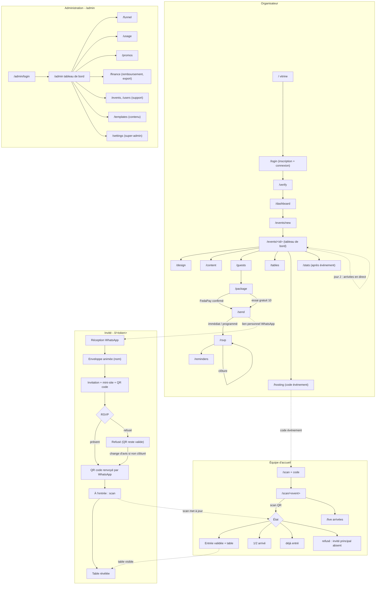

# 02 — App flow Convivia

> Toutes les pages du produit et ce qui se passe quand on clique. Quatre faces :
> **organisateur**, **invité** (lien personnel, sans compte), **équipe d'accueil**
> (scan), **administration** (par rôle). Source amont : `01-prd.md`.

## Conventions

- **Domaine unique** : `convivia.app` (URLs notées en chemins relatifs).
- **Mobile-first** pour toutes les faces **sauf l'administration** (pensée desktop).
- **Accès invité** : tout passe par le **lien personnel** `/i/<token>`. Aucune URL
  d'événement publique ; rien n'est visible sans le lien.
- **Accès équipe d'accueil** : `/scan` + **code d'événement** (pas de compte).
- **Création d'événement** : création minimale, puis **tableau de bord d'événement
  avec sections éditables librement** ; l'envoi reste bloqué tant que le paiement
  n'est pas confirmé.
- **Administration** : sous-chemin `/admin`.
- Format de chaque page : **Nom · URL · Qui · But · Actions → état/page suivante**.

---

## 1. Face organisateur

### 1.1 Vitrine publique
- **URL** : `/`
- **Qui** : visiteur non connecté.
- **But** : présenter Convivia, donner envie de créer un événement.
- **Actions** :
  - « Créer mon événement » et « Se connecter » → `/login` (même écran)
  - Ouvrir un **lien de suivi** (code promo/influenceur) → `/signup?ref=<code>`
    (redirigé vers `/login?ref=<code>` ; le code est mémorisé pour
    l'inscription et le paiement).

### 1.2 Inscription et connexion (écran unique)
Décision du 2026-10-20 : inscription et connexion sont **un seul parcours**,
qui ne révèle jamais si un compte existe déjà.
- **URL** : `/login` (point d'entrée unique). `/signup` reste une adresse
  valide qui **redirige vers `/login` en conservant `?ref=`** (liens de suivi
  déjà diffusés).
- **Qui** : visiteur ou organisateur existant.
- **But** : entrer dans son espace, en créant le compte s'il n'existe pas.
- **Actions** :
  - Saisir son **numéro WhatsApp** → envoi d'un code → `/verify`
  - Ou saisir son **email** → envoi d'un **code à 6 chiffres** par email (sans
    mot de passe) → `/verify`
  - Le message affiché est **le même** que le compte existe ou non (« Nous
    vous avons envoyé un code »).

### 1.3 Vérification
- **URL** : `/verify`
- **Qui** : visiteur en cours d'inscription/connexion.
- **But** : saisir le code reçu (WhatsApp ou email).
- **Actions** :
  - Code correct → `/dashboard` (compte créé à ce moment s'il n'existait pas).
    **Première connexion** : écran « Votre profil » (nom, ville, pays)
    avant le tableau de bord (TRD D44)
  - « Renvoyer le code » (après 60 s) → reste sur `/verify`
  - Code invalide → message d'erreur, reste sur `/verify`
  - **5 codes faux → blocage de 15 min** (décision du 2026-10-20)

### 1.4 Connexion
Fusionnée avec l'inscription (§ 1.2).

### 1.5 Tableau de bord — mes événements
- **URL** : `/dashboard`
- **Qui** : organisateur connecté.
- **But** : lister ses événements et leur état (brouillon, essai, payé,
  programmé, envoyé, clôturé, passé — les 7 états de `07-schema-backend.md`
  § 4.1).
- **Actions** :
  - « Nouvel événement » → `/events/new`
  - Ouvrir un événement → `/events/<id>`
  - Paramètres du compte → `/account`

### 1.6 Création d'événement (minimale)
- **URL** : `/events/new`
- **Qui** : organisateur.
- **But** : cadrer l'événement : **type** (mariage, dot, baptême, anniversaire,
  sortie d'enfant, autre), nom, date, lieu, **pays** (obligatoire : il fixe le
  fuseau horaire ; modifiable jusqu'au premier envoi, décisions du
  2026-10-20), hôtes.
- **Actions** :
  - Valider → création → `/events/<id>` (tableau de bord d'événement)
  - Annuler → `/dashboard`
- **Note** : le type reste modifiable jusqu'au premier envoi, puis il est figé.

### 1.7 Tableau de bord d'un événement
- **URL** : `/events/<id>`
- **Qui** : organisateur propriétaire.
- **But** : piloter l'événement ; point d'entrée vers toutes les sections ;
  rappelle l'état (payé ? envoyé ? RSVP ouverts/clôturés ?).
- **Actions (sections éditables dans n'importe quel ordre)** :
  - Design → `/events/<id>/design`
  - Contenu & photos → `/events/<id>/content`
  - Invités → `/events/<id>/guests`
  - Forfait & paiement → `/events/<id>/package`
  - Aperçu & envoi → `/events/<id>/send`
  - Suivi RSVP → `/events/<id>/rsvp`
  - Tables → `/events/<id>/tables`
  - Équipe d'accueil → `/events/<id>/hosting`
  - Après l'événement → `/events/<id>/stats`
  - Modifier date/lieu → édition inline (voir § 1.17)
  - **Le jour J** : bloc **« Arrivées en direct »** (entrés, 1/2 arrivés,
    restants), mis à jour en temps réel (TRD § 6.4 ; décision du 2026-10-20)

### 1.8 Design : template puis style d'enveloppe
- **URL** : `/events/<id>/design`
- **Qui** : organisateur.
- **But** : choisir **1 template parmi les 2** du type, puis **1 style d'enveloppe
  parmi les 3**.
- **Actions** :
  - Sélectionner un template → aperçu mis à jour
  - Sélectionner un style d'enveloppe → aperçu (couleurs adaptées à la palette du
    template)
  - Enregistrer → retour `/events/<id>`
- **Note** : pas d'édition libre du design (mise en page, polices, couleurs,
  animation restent fixes).

### 1.9 Contenu & photos
- **URL** : `/events/<id>/content`
- **Qui** : organisateur.
- **But** : remplir message d'invitation, programme, infos pratiques, dress code,
  noms, et déposer les photos dans les emplacements prévus.
- **Actions** :
  - Éditer les champs / téléverser photos → enregistrement
  - « Aperçu » → aperçu du mini-site tel que l'invité le verra
  - Enregistrer → retour `/events/<id>`

### 1.10 Invités
- **URL** : `/events/<id>/guests`
- **Qui** : organisateur.
- **But** : constituer la liste **un par un** (pas d'import).
- **Actions** :
  - « Ajouter un invité » : **prénom** (obligatoire) + **nom** (facultatif,
    TRD D45) + numéro WhatsApp + type **individuelle** ou
    **avec accompagnant** (« Nom + 1 », nom de l'accompagnant optionnel) → ajouté
    à la liste. Le compteur d'invités tient compte du « +1 » qui **compte pour 2**.
    Case obligatoire : « Cet invité accepte de recevoir son invitation par
    WhatsApp » (attestation, PRD § 7.14). **Groupe** facultatif : choisir un
    groupe existant ou en créer un à la volée (PRD § 5.1). Un numéro déjà
    présent dans la liste est accepté (couple partageant un numéro).
  - Gérer les **groupes** : créer, renommer, supprimer (les invités du groupe
    supprimé restent, sans groupe) ; filtrer la liste par groupe.
  - Un invité présent dans la liste d'exclusion WhatsApp est signalé « a refusé
    les messages WhatsApp » → action « Copier son lien » pour le lui transmettre
    soi-même. Bouton actif seulement si l'événement est payé ou en essai **et**
    l'invité dans le plafond (pas « en attente de paiement »). La première
    copie **compte comme un envoi** (place occupée, type figé, QR créé), sans
    coût WhatsApp ni quota ; recopier ensuite est libre (TRD D42).
  - « **Afficher son QR** » (après l'envoi) → QR de l'invité en plein écran,
    pour le faire scanner à l'entrée s'il n'a plus le sien (PRD § 7.8).
  - Modifier / supprimer un invité → liste mise à jour. Le **type**
    (individuelle / avec accompagnant) n'est plus modifiable une fois
    l'invitation de cet invité envoyée.
  - « **Renvoyer l'invitation** » (après un échec de livraison ou un
    changement de numéro) : 1 renvoi gratuit, ensuite compté dans le quota de
    3 messages (PRD § 7.10).
  - Indicateur : total décompté vs plafond (voir § 1.11). Pendant l'essai seul,
    l'ajout d'un 11e invité est refusé. Après un paiement, l'ajout reste libre :
    parmi les invités pas encore envoyés, les derniers ajoutés au-delà du
    plafond sont marqués **« en attente de paiement »** et ne reçoivent rien
    tant que le complément n'est pas payé ; un invité déjà envoyé ne l'est
    jamais (PRD § 7.5).
  - Aller au forfait → `/events/<id>/package`

### 1.11 Forfait & paiement
- **URL** : `/events/<id>/package`
- **Qui** : organisateur.
- **But** : choisir le forfait selon le nombre d'invités et payer **avant l'envoi**.
- **Actions** :
  - Voir la grille (10 offerts, 50/100/200/300/500/1000) et le total calculé ;
    au-delà de 1000 → **demande de devis**.
  - Appliquer un **code promo** (remise % ou montant fixe, 15 % au maximum) →
    total recalculé
  - « Payer avec FedaPay » → `/events/<id>/package/checkout` → page FedaPay
  - Utiliser l'**essai gratuit** (10 invités offerts, 1 par numéro vérifié) →
    débloque l'envoi sans paiement, dans la limite de 10. Compte créé par
    email : vérifier d'abord un numéro WhatsApp. Proposé seulement avant tout
    paiement de l'événement, et seulement si la liste compte 10 places ou
    moins (TRD D43). Si un forfait est payé ensuite, les 10 offertes
    s'ajoutent aux places payées (PRD § 7.4).
  - Après un paiement : **passer au forfait supérieur** (paiement de la
    différence de prix catalogue) ou **ajouter des invités** au prix unitaire du
    palier ; l'écran propose la moins chère des deux. Le code promo ne
    s'applique qu'au premier paiement. Après un remboursement, le passage de
    palier part de la valeur déjà acquise (PRD § 7.1, TRD D40).
  - Consulter l'**historique des paiements** de l'événement, avec les
    **remboursements** éventuels (montant, statut, date ; sans le motif
    interne).
- **États de retour** :
  - Paiement confirmé → retour `/events/<id>/package` avec statut **payé** →
    l'envoi est débloqué
  - Paiement échoué/annulé → retour avec message, envoi toujours bloqué

### 1.12 Aperçu & envoi
- **URL** : `/events/<id>/send`
- **Qui** : organisateur.
- **But** : vérifier puis envoyer les invitations par WhatsApp.
- **Pré-condition** : paiement confirmé (ou essai gratuit ; jamais après un
  remboursement total, PRD § 7.12). Sinon, bouton d'envoi
  désactivé avec renvoi vers `/events/<id>/package`.
- **Actions** :
  - « Aperçu » d'une invitation (enveloppe + mini-site vus par l'invité)
  - « Envoyer maintenant » → chaque invité reçoit son **lien personnel** (le QR
    code est visible sur sa page et renvoyé en image après confirmation, D14)
    → état **envoyé** → `/events/<id>/rsvp`
  - « Programmer l'envoi » (date/heure) → état **programmé** → `/events/<id>`
  - Après un premier envoi, l'ajout de nouveaux invités reste libre ; les
    invités **en excédent** (au-delà du plafond) sont exclus de l'envoi et
    signalés « en attente de paiement », avec un lien vers
    `/events/<id>/package` pour payer le complément (PRD § 7.5).

### 1.13 Suivi RSVP
- **URL** : `/events/<id>/rsvp`
- **Qui** : organisateur.
- **But** : suivre les réponses en temps réel.
- **Actions** :
  - Filtrer : ouvertes / confirmées / refusées / sans réponse
  - Relancer → `/events/<id>/reminders` (ou action rapide de relance)
  - **Clôturer les RSVP** (bouton dédié) → confirmation → état **clôturé** ;
    après clôture, les invités ne peuvent plus modifier leur réponse.

### 1.14 Relances
- **URL** : `/events/<id>/reminders`
- **Qui** : organisateur.
- **But** : récupérer les sans-réponse.
- **Actions** :
  - Activer/désactiver les **relances automatiques** des sans-réponse (2 au
    maximum : J+3 après l'envoi, J-7 avant l'événement ; une seule à J+3 si
    l'événement a lieu 10 jours ou moins après l'envoi, et seulement avant le
    jour J — PRD § 7.10)
  - Envoyer un **message groupé** (sélection) ou **individuel**, choisi parmi des
    modèles fixes → envoi WhatsApp ; **quota de 3 messages par invité**
    (remerciement compris), bouton désactivé au-delà
  - Retour `/events/<id>/rsvp`

### 1.15 Tables
- **URL** : `/events/<id>/tables`
- **Qui** : organisateur.
- **But** : créer les tables et affecter les invités.
- **Actions** :
  - Créer des tables **nommées ou numérotées** (au choix)
  - Affecter chaque invité à une table ; filtrer et regrouper par **groupe
    d'invités** (ex. côté marié / côté mariée), pour tous les types
  - Enregistrer → retour `/events/<id>`
- **Note** : la table n'est **jamais visible par l'invité avant le scan**.

### 1.16 Équipe d'accueil
- **URL** : `/events/<id>/hosting`
- **Qui** : organisateur.
- **But** : préparer le contrôle à l'entrée.
- **Actions** :
  - Générer / afficher le **code d'événement** (8 caractères) à communiquer à
    l'équipe d'accueil ; il n'est **actif que de J-1 à J+1** ; il reste
    réaffichable à tout moment
  - Voir les **appareils connectés** au scan (« Appareil 1 », « Appareil 2 »…)
  - Activer/désactiver le **mode strict** (entrée validée seulement si l'invité
    principal et l'accompagnant sont présents ensemble)
  - Révoquer/régénérer le code → anciens accès invalidés
  - Suivre les arrivées en direct → **tableau de bord de l'événement**
    `/events/<id>` le jour J (décision du 2026-10-20) ; la page
    `/events/<id>/stats` reste réservée à l'après-événement

### 1.17 Modifier date / lieu (après envoi)
- **Où** : édition depuis `/events/<id>`.
- **But** : changer la date ou le lieu même après l'envoi.
- **Actions** :
  - Modifier → le mini-site se met à jour pour tous ; une **notification WhatsApp
    de changement** est envoyée à tous les invités sauf ceux qui ont décliné
    (une seule notification si plusieurs modifications dans l'heure) ; les **QR
    codes restent valides**.

### 1.18 Après l'événement
- **URL** : `/events/<id>/stats`
- **Qui** : organisateur.
- **But** : clore proprement.
- **Actions** :
  - Consulter les **statistiques de présence** (scannés, 1/2 arrivés, absents)
  - Envoyer un **message de remerciement** (groupé) aux **invités présents**
    (scannés à l'entrée) uniquement → envoi WhatsApp (PRD § 6.15)

### 1.19 Compte
- **URL** : `/account`
- **Qui** : organisateur.
- **But** : gérer son compte.
- **Actions** :
  - Modifier ses infos, se déconnecter, **déconnecter toutes ses sessions**
    (tous les appareils, TRD § 7.4)
  - Supprimer un événement ou le compte → **supprime les données des invités**
    associées (conservation jusqu'à cette suppression ou sur demande) ; les
    paiements, remboursements et statistiques agrégées sont conservés sans
    donnée personnelle (PRD § 7.13)
- **Compte suspendu** : bandeau « Compte suspendu, contactez le support » ;
  consultation possible, toutes les actions de modification et d'envoi
  désactivées.

---

## 2. Face invité (sans compte, lien personnel)

Tout vit sous `/i/<token>`. Le token identifie l'invité et son invitation.

### 2.1 Réception
- **Canal** : message WhatsApp avec le **lien personnel** `/i/<token>`.
- **But** : amener l'invité à ouvrir son invitation.

### 2.2 Enveloppe animée
- **URL** : `/i/<token>` (état initial)
- **Qui** : invité détenteur du lien.
- **But** : ouverture soignée et personnalisée.
- **Actions** :
  - Animation de l'enveloppe **avec le nom de l'invité** (lancée automatiquement,
    `05-templates-enveloppes.md` § 1.2) → état « invitation » (même URL).
    L'ouverture est enregistrée (RSVP « ouverte ») à la fin de l'animation, pas
    au simple chargement de la page.

### 2.3 Invitation & mini-site
- **URL** : `/i/<token>` (après ouverture)
- **Qui** : invité.
- **But** : montrer l'invitation (texte, photos, date, lieu) et le mini-site
  (programme, lieu, infos pratiques, dress code).
- **Actions** :
  - Répondre → bloc RSVP (§ 2.4)
  - Consulter le programme, le lieu, les infos

### 2.4 RSVP
- **URL** : `/i/<token>` (bloc RSVP)
- **Qui** : invité.
- **But** : confirmer ou décliner.
- **Actions** :
  - « Je serai présent » → **confirmé** → QR code renvoyé par WhatsApp (§ 2.5)
  - « Je ne pourrai pas venir » → **refusé**
  - Changer d'avis (si refusé) → « Finalement présent » → confirmé, **tant que
    l'organisateur n'a pas clôturé** les réponses
  - L'invité **ne peut pas** ajouter d'accompagnant ni changer le nombre de places
  - Après **clôture** : boutons désactivés, message « Réponses clôturées »

### 2.5 QR code
- **URL** : `/i/<token>` (dès l'ouverture de l'invitation)
- **Qui** : tout invité détenteur du lien, quelle que soit sa réponse.
- **But** : fournir le titre d'entrée.
- **Actions** :
  - Le **QR code personnel** est créé à l'envoi et **visible dès l'ouverture**
    (après l'enveloppe) ; il est **renvoyé en image par WhatsApp** après
    confirmation
  - **Un seul QR code** par invitation, y compris « +1 » (2 entrées)

### 2.6 Après le scan — ma table
- **URL** : `/i/<token>` (état après scan à l'entrée)
- **Qui** : invité scanné.
- **But** : révéler la table.
- **Déclencheur** : le scan à l'entrée par l'équipe d'accueil.
- **Effet** : la **table** (nom ou numéro) devient visible sur la page de l'invité.
  Elle **n'est pas visible avant** le scan.

---

## 3. Face équipe d'accueil (scan)

### 3.1 Accès au scan
- **URL** : `/scan`
- **Qui** : membre de l'équipe d'accueil (sans compte).
- **But** : rejoindre l'événement à contrôler.
- **Actions** :
  - Saisir le **code d'événement** → `/scan/<event>` (écran de scan)
  - Code invalide/révoqué, pas encore actif (avant J-1) ou expiré (après J+1)
    → message d'erreur, reste sur `/scan`
  - 5 codes faux → blocage de 15 min sur l'appareil
  - Session de scan valable 24 h sur l'appareil

### 3.2 Écran de scan
- **URL** : `/scan/<event>`
- **Qui** : équipe d'accueil autorisée (connexion internet requise, pas de mode
  hors ligne).
- **But** : contrôler les entrées.
- **Actions** :
  - Scanner un QR code → affiche l'**état** et la **table** de l'invité :
    - **Individuelle valide** → « Entrée validée » + table
    - **Avec accompagnant** → l'écran affiche les noms et 3 boutons :
      « Les deux » / « Invité principal seul » / « Accompagnant seul »
    - **Les deux** → « Entrée validée (2/2) » + table
    - **Invité principal seul** → « 1/2 arrivé » (invité principal enregistré)
    - **Accompagnant seul, principal déjà entré** → « Entrée validée (2/2) » +
      table
    - **Déjà scanné** → « déjà entré »
    - **Accompagnant seul, principal absent** → « refusé : invité principal
      absent »
    - **Mode strict activé** → entrée validée **seulement si les deux ensemble**,
      sinon « refusé : les deux personnes doivent être présentes » (seul le
      bouton « Les deux » est proposé au premier passage)
    - **Invité sans réponse ou ayant décliné** → entrée validée avec la mention
      « n'avait pas confirmé » / « avait décliné » ; sa réponse passe à
      « présent »
    - **Deux scanners sur le même QR au même moment** → un seul passage
      enregistré, l'autre écran affiche « déjà entré »
  - Scanner le suivant → même écran
  - Voir les arrivées en direct → `/scan/<event>/live`
  - **Invité sans QR** : aucune recherche par nom ; l'équipe le renvoie vers
    l'organisateur, qui affiche son QR depuis `/events/<id>/guests`

### 3.3 Arrivées en direct
- **URL** : `/scan/<event>/live`
- **Qui** : équipe d'accueil.
- **But** : suivre le flux des arrivées en temps réel.
- **Actions** :
  - Compteurs (entrés, 1/2 arrivés, restants) ; retour `/scan/<event>`

---

## 4. Face administration (`/admin`, desktop)

Accès selon le rôle (§ 4 du PRD). **Aucun écran admin n'affiche les coordonnées
des invités** (nom + numéro WhatsApp).

### 4.1 Connexion admin
- **URL** : `/admin/login`
- **Qui** : compte admin.
- **But** : accéder à l'espace d'administration.
- **Actions** : email + mot de passe, puis **code de double authentification
  (TOTP) obligatoire** → `/admin` (tableau de bord selon rôles). Pas
  d'inscription publique : les comptes admin sont créés par le super-admin.
- **Règles d'accès admin** (décision du 2026-10-20) :
  - **Erreurs** : un seul message, « Identifiants ou code incorrects », que
    l'erreur porte sur l'e-mail, le mot de passe ou le code TOTP. **5 échecs**
    (mot de passe et TOTP confondus) sur un compte → **blocage de 15 min** ;
    chaque blocage est inscrit au journal d'audit.
  - **Première connexion** : enrôlement TOTP obligatoire (QR code + clé à
    saisir), validé par un premier code ; **10 codes de secours** à usage
    unique sont affichés une seule fois.
  - **Mot de passe oublié** (`/admin/reset`) : lien par e-mail à usage unique,
    valable **30 min**, même message que le compte existe ou non ; après
    changement, toutes les sessions admin du compte sont fermées ; le TOTP
    reste exigé.
  - **Téléphone TOTP perdu** : connexion avec un code de secours, ou
    **réinitialisation du TOTP par un super-admin** (motif obligatoire,
    journalisée) puis nouvel enrôlement. Dernier super-admin sans code de
    secours : réinitialisation manuelle par le propriétaire du projet dans la
    console Supabase, consignée hors application (TRD § 8.1).
  - **Session** : **8 h** au maximum, fermée après **30 min d'inactivité**.

### 4.2 Tableau de bord principal
- **URL** : `/admin`
- **Qui** : super-admin, et selon rôle (marketing, finance, etc. voient leurs
  blocs).
- **But** : vue de croissance.
- **Contenu** : utilisateurs (inscrits, actifs, nouveaux), revenu total et
  évolution, revenu par type/forfait, panier moyen, événements créés/payés.
- **Actions** : naviguer vers les sections ci-dessous selon droits.

### 4.3 Entonnoir de conversion — *marketing, super-admin*
- **URL** : `/admin/funnel`
- **But** : visiteur → inscrit → événement créé → invitations envoyées → paiement,
  avec taux de passage.

### 4.4 Qualité d'usage — *marketing, super-admin*
- **URL** : `/admin/usage`
- **But** : taux d'ouverture, taux de RSVP, taux de présence scannée ;
  fidélisation (2e événement) ; répartition ville/pays/type, saisonnalité.

### 4.5 Codes promo & influenceurs — *marketing, super-admin*
- **URL** : `/admin/promos`
- **But** : créer/paramétrer les codes et liens de suivi, suivre leurs stats.
- **Actions** :
  - Créer un code : remise % ou montant fixe, **ou** simple suivi sans remise ;
    durée, limite d'utilisation, canal/influenceur rattaché → `/admin/promos/<id>`
    (remise en % refusée au-delà de 15 % à la création ; remise à montant
    fixe ramenée à 15 % du total au paiement, PRD § 7.1)
  - Créer un **lien de suivi** associé
  - Voir stats par code : utilisations, inscriptions, paiements, revenu généré,
    remise, revenu net, conversion, panier moyen
  - Comparer influenceurs (même type de code)

### 4.6 Finances — *finance, super-admin*
- **URL** : `/admin/finance`
- **But** : paiements FedaPay, marges par événement, panier moyen, revenu.
- **Actions** :
  - Consulter les transactions, **marges** (prix payé − coûts WhatsApp/stockage/
    frais FedaPay)
  - Déclencher un **remboursement** (acte exceptionnel, manuel, tracé) :
    enregistré dans Convivia, exécuté hors de l'app (tableau de bord FedaPay
    pour MTN, transfert manuel sinon), puis référence saisie → « remboursé »
  - **Exporter en Excel**

### 4.7 Gestion événements & utilisateurs — *support, super-admin*
- **URL** : `/admin/events`, `/admin/users`
- **But** : recherche et assistance.
- **Actions** :
  - Rechercher un organisateur/événement, voir l'état (RSVP, envoi, paiement
    payé/échoué) — **sans coordonnées des invités** ; coordonnées de
    l'organisateur visibles (PRD § 4)
  - Ajouter une **note interne** sur un organisateur ou un événement
    (historique partagé support / super-admin, jamais visible par
    l'organisateur, non modifiable)
  - **Suspendre / réactiver** un compte organisateur — *super-admin seulement*,
    avec motif obligatoire, tracé dans le journal d'audit
  - Support **ne peut pas** rembourser ni modifier les prix ; il ne modifie
    aucune donnée de l'organisateur

### 4.8 Contenu (templates & enveloppes) — *contenu, super-admin*
- **URL** : `/admin/templates`
- **But** : gérer les **12 templates** et **3 styles d'enveloppe** (définition,
  aperçus, emplacements photos).

### 4.9 Réglages plateforme — *super-admin*
- **URL** : `/admin/settings`
- **But** : forfaits, prix, pays ; gestion des **comptes admin et de leurs rôles**
  (cumul de rôles possible) ; action **« Réinitialiser la double
  authentification »** d'un admin (motif obligatoire, journalisée, § 4.1).

---

## 5. Schéma des parcours (Mermaid)

---

## 6. Incohérences relevées avec le PRD

Deux **renvois internes erronés** avaient été relevés dans `01-prd.md` et ont été
**corrigés le 2026-10-20** :

1. **§ 6.12 (Gestion des tables)** renvoyait à « (§ 7.5) » pour la table visible
   seulement après le scan → corrigé en **(§ 7.7)** (§ 7.5 traite de l'ajout
   d'invités après un premier envoi).
2. **§ 6.14 (Contrôle à l'entrée)** renvoyait à « (§ 7.6) » pour les règles
   d'entrée → corrigé en **(§ 7.8)** (§ 7.6 traite du RSVP, changement d'avis et
   clôture).

Aucune contradiction de fond relevée entre les décisions de structure de ce
document et les règles métier du PRD.
