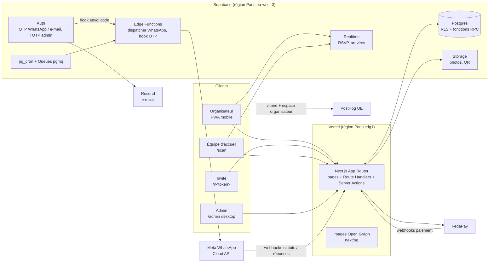

# 06 — TRD Convivia (document technique)

> Comment on construit Convivia : architecture, WhatsApp, paiement FedaPay,
> QR codes et scan, authentification et droits, statistiques, données,
> environnements. Sources amont : `00-synthese-convivia.pdf`, `01-prd.md` à
> `05-templates-enveloppes.md`. Rédigé le **2026-10-20** ; les informations
> fournisseurs (Meta, FedaPay, Supabase) ont été vérifiées à cette date dans
> leur documentation publique.
>
> **Légende** : ✅ vérifié dans la doc officielle · ⚠️ à confirmer (doc
> incomplète ou contradictoire) · ❌ impossible / non proposé par le fournisseur.

---

## 0. Décisions prises pendant la rédaction

Ces décisions ont été tranchées avec le porteur du projet pendant l'écriture du
TRD. Celles qui touchent une règle métier doivent être reportées dans les
documents 01 à 05 (voir § 17).

| # | Sujet | Décision |
|---|---|---|
| D1 | Fournisseur WhatsApp | **API Cloud de Meta en direct**, sans intermédiaire |
| D2 | Consentement des invités | **Attestation** de l'organisateur à l'ajout de chaque invité + **bouton « Ne plus recevoir »** dans les messages + **liste d'exclusion** commune à toute la plateforme |
| D3 | Relances automatiques | **2 au maximum** par invité sans réponse : **J+3** après l'envoi, puis **J-7** avant l'événement. Événement à 10 jours ou moins de l'envoi : voir **D29** (remplace l'ancien repli « J+7 ») |
| D4 | Messages manuels (groupés, individuels, remerciement) | **Quota de 3 messages par invité** en plus de l'invitation, du QR code, des relances automatiques et des notifications de changement. Uniquement des **modèles pré-validés par Meta** (pas de texte libre) |
| D5 | Passage au forfait supérieur | L'organisateur paie **la différence entre les prix catalogue** des deux forfaits. L'app propose aussi l'ajout d'invités au prix unitaire du palier et suggère la solution la moins chère |
| D6 | Code promo et paiements complémentaires | Remise appliquée au **premier paiement seulement**. L'attribution au code reste rattachée à l'événement et compte aussi le revenu des compléments |
| D7 | Remboursement | **Tracé dans Convivia, exécuté hors de l'app** (tableau de bord FedaPay pour MTN, transfert mobile money manuel pour les autres moyens) |
| D8 | Événement après un remboursement total | **Retour en brouillon, envois bloqués** (bonus d'essai éventuel gardé pour un paiement futur : D35). Les liens déjà envoyés restent ouvrables. Un remboursement partiel réduit les **places payées** en proportion (effet sur les envois : D36) |
| D9 | Société porteuse | **Pas encore créée**. Sa création est un **prérequis bloquant** pour FedaPay en mode réel et pour la vérification d'entreprise Meta |
| D10 | Connexion par e-mail | **Code à 6 chiffres par e-mail**, sans mot de passe |
| D11 | Essai gratuit | Exige un **numéro WhatsApp vérifié**, y compris pour un compte créé par e-mail |
| D12 | Code de l'équipe d'accueil | 8 caractères, **actif de J-1 à J+1**, session de 24 h, 5 essais ratés = blocage de 15 min, révocable |
| D13 | Comptes admin | **Double authentification (TOTP) obligatoire pour tous** |
| D14 | Moment de remise du QR code | **Dès l'envoi**. Le 1er message ne contient que le lien ; le QR est visible sur la page après l'enveloppe, puis renvoyé en image WhatsApp après confirmation |
| D15 | Scan d'un invité non confirmé ou qui a décliné | **Entrée acceptée avec une mention** (« n'avait pas confirmé » / « avait décliné ») ; l'invité passe automatiquement en « présent » |
| D16 | Notification de changement de date ou de lieu | Envoyée à **tous sauf ceux qui ont décliné** ; hors quota ; une seule notification par heure (les modifications sont regroupées) |
| D17 | Hébergement | **Vercel** |
| D18 | Mesure des visiteurs | **PostHog, hébergement en Europe**, jamais sur les pages invités |
| D19 | Attribution lien / code | **Le code saisi au paiement l'emporte**. Le lien de suivi est mémorisé 30 jours et rattaché définitivement au compte à l'inscription |
| D20 | Scan d'un « Nom + 1 » | **Choix après le scan** : « Les deux » / « Invité principal seul » / « Accompagnant seul » |
| D21 | Animation d'enveloppe (point ouvert du 05 § 4) | **CSS + SVG** (voir § 11.3) |
| D22 | Grille de prix | **+50 FCFA sur chaque palier** : 200 · 190 · 175 · 165 · 155 · 150 FCFA/invité ; devis ≥ 150 FCFA (reporté dans `01-prd.md` § 7.1) |

Décisions du **2026-10-20**, prises à la création de `09-conventions.md`
(reportées dans 01, 02, 03, 04 et 07). D33 (valeurs admin), D34 à D39 ont
été proposées par le pilote et retenues par le porteur du projet (de même
que D40 à D42) :

| # | Sujet | Décision |
|---|---|---|
| D23 | Inscription et connexion | **Un seul parcours** : point d'entrée `/login` ; `/signup` redirige vers `/login` en conservant `?ref=`. Le code est envoyé dans tous les cas ; **aucun message ne révèle si un compte existe** |
| D24 | Code de connexion (organisateur) | **5 codes faux → blocage de 15 min**, compteur côté serveur (en plus de l'expiration 10 min et du renvoi 60 s, § 7.1) |
| D25 | Pays de l'événement | **Obligatoire à la création** ; il fixe `events.timezone` |
| D26 | Dépassement du plafond après paiement | **Ajout libre** ; parmi les invités pas encore envoyés, les **derniers ajoutés** au-delà du plafond sont **« en attente de paiement »** et ne reçoivent rien tant que le complément n'est pas payé ; les autres reçoivent normalement (voir D37) |
| D27 | Essai gratuit et forfait | Pendant l'essai seul : **11e invité refusé**. Ensuite, les 10 offertes sont un **bonus fixe** : plafond = places payées + 10 ; prix, options et remboursements calculés sur les places payées ; après remboursement total, le bonus est gardé pour un paiement futur (D35) |
| D28 | Renvoi d'une invitation | **1 renvoi gratuit** par invité, hors quota, seulement après un échec de livraison ou un changement de numéro ; ensuite compté dans le quota de 3 (D4). Même lien, même QR |
| D29 | Relances, événement proche | Événement à **10 jours ou moins** de l'envoi : **une seule** relance à J+3, et seulement si elle tombe avant le jour de l'événement |
| D30 | Remerciement | Envoyé aux **présents scannés** uniquement |
| D31 | Arrivées en direct (organisateur) | Sur le **tableau de bord de l'événement** `/events/<id>` le jour J ; `/events/<id>/stats` reste pour l'après-événement |
| D32 | Type d'invitation | Individuelle / avec accompagnant **figé dès que l'invitation de l'invité est envoyée** |
| D33 | Accès admin | Message unique « Identifiants ou code incorrects » ; **5 échecs** (mot de passe et TOTP confondus) → **blocage de 15 min**, journalisé ; enrôlement TOTP à la première connexion + **10 codes de secours** ; mot de passe oublié par lien e-mail à usage unique de **30 min** (toutes les sessions fermées après changement) ; TOTP perdu → code de secours ou réinitialisation par un super-admin (motif, journal) ; dernier super-admin sans facteur → réinitialisation manuelle par le propriétaire du projet dans la console Supabase, consignée hors application ; session **8 h** max, **30 min** d'inactivité (§ 8.1) |
| D34 | Plafond des remises | Une remise ne dépasse **jamais 15 %** du montant, sur tous les paliers et sur devis ; un code à montant fixe est plafonné à 15 % du total ; contrôle côté serveur (§ 2.4, § 3.2) |
| D35 | Remboursement total après un essai | Brouillon, **aucun envoi** ; les 10 offertes sont **gardées pour plus tard** et ne resservent qu'avec un nouveau paiement (plafond = places payées + 10) |
| D36 | Remboursement partiel | Places payées réduites en proportion, puis **règle du dépassement** (D26, D37) : seuls les invités en excédent pas encore envoyés sont « en attente de paiement » ; les invités déjà servis gardent QR, relances et notifications |
| D37 | Invités déjà envoyés | **Jamais en excédent** : l'excédent ne touche que les invités pas encore envoyés, les derniers ajoutés d'abord |
| D38 | Essai après paiement | **Refusé** : l'essai n'est proposé qu'avant tout paiement de l'événement |
| D39 | Pays de l'événement | **Modifiable jusqu'au premier envoi**, figé ensuite (comme le type) ; voir D41 pour l'heure |
| D40 | Nouveau paiement après un remboursement | **Valeur déjà acquise** = prix catalogue du palier payé × (places payées restantes ÷ places du palier) ; passage à un palier = prix catalogue du nouveau palier − valeur déjà acquise (sans remboursement, c'est exactement D5). Après un remboursement total, valeur 0 : forfait complet au prix catalogue, sans code promo (D6). L'ajout au prix unitaire du palier verrouillé reste proposé, et l'écran met en avant la moins chère des deux options (§ 3.2) |
| D41 | Changement de pays de l'événement | L'**heure locale est conservée** (15 h reste 15 h dans le nouveau pays) : `starts_at`, envois programmés et relances sont recalculés dans le nouveau fuseau |
| D43 | Essai et liste déjà longue | `claim_trial` **refusé si la liste compte plus de 10 places** (« retirez des invités ou choisissez un forfait ») — décision du 2026-10-21 |
| D44 | Profil de l'organisateur | **Nom, ville, pays demandés après le premier code**, avant le tableau de bord ; modifiables dans `/account` ; le nom signe « De la part de [organisateur] » — 2026-10-21 |
| D45 | Nom de l'invité | **Prénom obligatoire** (variable des messages) + **nom facultatif** — 2026-10-21 |
| D46 | Ordre de construction | **Mariage** construit en premier de bout en bout (`08-plan-implementation.md`) — 2026-10-21 |
| D42 | « Copier son lien » (invité ayant refusé WhatsApp) | Bouton actif seulement si l'événement est payé ou en essai **et** l'invité dans le plafond. La **1re copie compte comme un envoi** (place occupée, type figé, jetons et QR créés), sans coût WhatsApp ni quota ; recopier ensuite est libre |

---

## 1. Architecture

### 1.1 Vue d'ensemble



### 1.2 Composants

| Composant | Rôle | Choix |
|---|---|---|
| Front + API | Pages, Server Actions, routes de webhooks, génération des exports | **Next.js (App Router)** sur **Vercel**, fonctions en région **Paris (`cdg1`)**, au plus près de la base |
| Base de données | Données métier, règles d'accès, logique transactionnelle (scan, paiement, quotas) | **Supabase Postgres** en région **Paris (`eu-west-3`)**. Supabase n'a pas de région en Afrique de l'Ouest ; Paris est la plus proche (~80–120 ms depuis Cotonou ou Abidjan) |
| Authentification | Organisateurs (OTP WhatsApp / e-mail), admins (e-mail + mot de passe + TOTP) | **Supabase Auth** |
| Temps réel | Tableau RSVP, arrivées en direct | **Supabase Realtime** (Broadcast déclenché par la base) |
| Tâches de fond | Envois programmés, relances, regroupement des notifications de changement, purges | **pg_cron** + **Supabase Queues (pgmq)** ; consommation par une Edge Function `whatsapp-dispatcher` |
| Fichiers | Photos des organisateurs, images des QR codes | **Supabase Storage** + CDN |
| WhatsApp | Tous les messages aux invités, codes de connexion | **Meta Cloud API** (§ 2) |
| Paiement | Encaissement des forfaits | **FedaPay** (§ 3) |
| E-mail | Codes de connexion par e-mail, e-mails système | **Resend** comme serveur d'envoi personnalisé de Supabase Auth (l'envoi Supabase par défaut est limité à quelques e-mails par heure, inutilisable en production) ✅ |
| Analyse | Visiteurs de la vitrine, entonnoir haut | **PostHog Cloud UE** (§ 13) |
| Erreurs | Suivi des erreurs | Sentry (offre gratuite), numéros et noms supprimés des rapports |

### 1.3 Principes

- **La base est la source de vérité.** Les règles critiques (scan, plafond
  d'invités, quotas WhatsApp, déblocage de l'envoi après paiement) sont des
  **fonctions Postgres** appelées par le serveur. Un client ne peut pas les
  contourner.
- **Aucune donnée sensible côté client sans contrôle** : RLS activé sur toutes
  les tables ; les pages invités et les écrans de scan passent par des routes
  serveur qui utilisent la clé de service, jamais par un accès direct du
  navigateur à la base.
- **Montants en entiers FCFA** (`integer`, code devise `XOF`), sans décimales.
- **Dates** stockées en `timestamptz` (UTC). Chaque événement porte son fuseau
  horaire, déduit du pays : Bénin = UTC+1 ; Côte d'Ivoire, Togo et Sénégal =
  UTC+0. Les envois programmés et les relances sont calculés dans ce fuseau.
- **Numéros de téléphone** normalisés en **E.164** à la saisie
  (`libphonenumber-js`).

---

## 2. WhatsApp

### 2.1 Ce que facture Meta ✅

Depuis le 1er juillet 2025, Meta facture **chaque message livré**, selon sa
**catégorie** et le **pays du destinataire**. Les messages envoyés par les
utilisateurs sont gratuits. **Bénin, Côte d'Ivoire, Togo et Sénégal** font
partie de la zone tarifaire **« Rest of Africa »**.

| Catégorie | Usage | Tarif Meta « Rest of Africa » (grille au 1er octobre 2026) | ≈ FCFA* |
|---|---|---|---|
| **Marketing** | Tout ce qui n'est pas strictement transactionnel | **0,0225 $** | **~13,5** |
| **Utilitaire** | Lié à une démarche précise de l'utilisateur (confirmation, mise à jour) | **0,0040 $** | **~2,4** |
| **Authentification** | Code à usage unique | **0,0040 $** | **~2,4** |
| **Service** | Réponse libre dans les 24 h qui suivent un message de l'utilisateur | 0,0040 $ après 1 000 gratuits par mois et par numéro | ~2,4 |

\* Conversion à **600 FCFA pour 1 $**, hypothèse prudente : le taux réel
2026 tourne autour de 560–590 FCFA, et le FCFA est lié à l'euro, pas au dollar.

Points à connaître :
- **Changement du 1er octobre 2026** ✅ : les messages utilitaires envoyés dans
  la fenêtre de 24 h, autrefois gratuits, sont désormais facturés. Les messages
  de service le sont aussi au-delà de 1 000 par mois et par numéro.
- **Meta peut modifier ses tarifs au début de chaque trimestre.** Les tarifs
  sont donc stockés dans une table `whatsapp_rates` modifiable par le
  super-admin, jamais codés en dur.
- **Remises sur volume** : elles n'existent que pour l'utilitaire et
  l'authentification. Elles sont calculées sur l'ensemble du portefeuille Meta
  et remises à zéro chaque mois.
- **Facturation Meta en dollars** (le FCFA ne fait pas partie des 16 devises
  proposées) : il faut une carte bancaire internationale au nom de la société.
  La devise est choisie à la création du compte et se change difficilement
  ensuite.
- Un message qui **échoue** (non livré) **n'est pas facturé**.

### 2.2 Classement des messages Convivia

Meta classe chaque modèle de message (*template*) et **le reclasse
automatiquement** en marketing s'il le juge mal déclaré (préavis d'un jour,
immédiat en cas d'abus répété). Un abus répété peut entraîner une restriction de
7 à 30 jours sur la création de modèles utilitaires. ✅ On déclare donc
honnêtement :

| Message | Catégorie visée | Justification |
|---|---|---|
| **Invitation** (1er envoi) | **Marketing** | Invitation sociale non sollicitée, sans transaction de l'invité ; Meta la classerait marketing de toute façon |
| **QR code après confirmation** | **Utilitaire** | Confirmation d'une démarche de l'invité (équivalent d'une confirmation de commande) |
| **Relance** (automatique ou manuelle) | **Marketing** | Incitation à répondre |
| **Changement de date ou de lieu** | **Utilitaire** (risque de reclassement) | Mise à jour d'un engagement existant. ⚠️ Pour un invité sans réponse, Meta peut la juger marketing ; on budgète 13,5 FCFA par prudence |
| **Remerciement** | **Marketing** | Message relationnel générique, explicitement cité par Meta comme marketing |
| **Messages manuels** | **Marketing** | Modèles fixes pré-validés (D4), choisis par l'organisateur ; pas de texte libre |
| **Code de connexion** | **Authentification** | Modèle standard Meta avec bouton « Copier le code » |

### 2.3 Comparatif des options

| Critère | **Meta Cloud API en direct** | Twilio | 360dialog | Agrégateurs (Infobip, Gupshup…) |
|---|---|---|---|---|
| **Coût par message** | Tarif Meta seul | Tarif Meta **+ 0,005 $** (~3 FCFA) par message, entrant comme sortant ✅ | Tarif Meta seul | Tarif Meta + marge sur devis (non publique) |
| **Coût fixe** | Aucun | Aucun | Abonnement par numéro : **49 à 99 €/mois** ⚠️ (tarifs 2026 contradictoires selon les sources) | Souvent un abonnement ou un engagement de volume |
| **Validation des modèles** | Par Meta (de quelques minutes à 24 h), via l'API ou WhatsApp Manager | Idem, depuis la console Twilio | Idem, depuis le hub 360dialog | Idem |
| **Consentement** | Règle Meta identique pour tous : la responsabilité revient à l'entreprise émettrice | Idem | Idem | Idem |
| **Statuts de livraison** | Webhooks `sent` / `delivered` / `read` / `failed`, avec le détail de facturation | Webhooks Twilio (re-mappés) | Webhooks Meta relayés | Selon le fournisseur |
| **Envoi programmé** | ❌ Non proposé, à construire nous-mêmes | ✅ Natif (Message Scheduling) | ❌ | Selon le fournisseur |
| **Relances** | À construire (file d'attente + minuteur) | À construire (la programmation aide) | À construire | Parfois des outils de campagne, peu adaptés à une relance invité par invité |
| **Code de connexion WhatsApp avec Supabase** | Par le *Send SMS Hook* de Supabase + notre Edge Function | ✅ Intégration native Supabase (Twilio / Twilio Verify) | Par le hook | Par le hook |
| **Test sans envoi réel** | Numéro de test Meta gratuit, vers 5 numéros autorisés au maximum | Sandbox Twilio | Sandbox 360dialog | Variable |

**Recommandation retenue (D1) : Meta Cloud API en direct.** C'est l'option la
moins chère par message et elle n'ajoute aucun intermédiaire. L'envoi programmé
et les relances sont à coder dans tous les cas, sauf chez Twilio ; Twilio coûte
environ 20 à 40 % de plus sur chaque message pour éviter ce travail.

### 2.4 Coût réel par invité et hypothèse des 50 FCFA

On calcule par **destinataire** (une invitation « Nom + 1 » = **un seul**
destinataire pour 2 places payées). Avec D3, D4, D16 et D28 :

| Scénario (par destinataire) | Messages | Coût ≈ |
|---|---|---|
| Confirme sans relance, reçoit le remerciement | invitation 13,5 + QR 2,4 + remerciement 13,5 | **~29 FCFA** |
| Confirme après 1 relance | + 13,5 | **~43 FCFA** |
| Ne répond jamais (2 relances), reçoit la notification de changement | 13,5 + 27 + 13,5 (prudent) | **~54 FCFA** |
| **Pire cas** : renvoi gratuit après changement de numéro (D28) + 2 relances + changement + quota manuel épuisé (3) | 13,5 + 13,5 (renvoi) + 27 + 13,5 + 40,5 + 2,4 (QR) | **~110 FCFA** |

**Moyenne attendue pour un événement** (60 % répondent sans relance, 25 %
après une, 15 % après deux, remerciement envoyé aux présents seulement (D30), pas de message
manuel supplémentaire) : **~35–40 FCFA par destinataire**. Avec 20 % de
« Nom + 1 », cela donne **~30–33 FCFA par place payée**.

**Verdict sur l'hypothèse des 50 FCFA : confirmée comme moyenne prudente**,
avec trois nuances :
1. Ce n'est **pas un plafond** : le pire cas autorisé par les quotas est
   d'environ 110 FCFA par destinataire depuis le renvoi gratuit (D28 ; 97
   FCFA avant). Avec l'ancienne grille (150 → 100 FCFA), le palier 1 000 était
   **à perte** dans ce cas. La grille a donc été **relevée de 50 FCFA sur
   chaque palier** (D22). Marge par invité individuel dans le pire cas (coût
   WhatsApp 110 FCFA, commission 4 %) :

   | Forfait | Prix / invité | Commission 4 % | **Marge pire cas** |
   |---|---|---|---|
   | 50 | 200 | 8,0 | **+82** |
   | 100 | 190 | 7,6 | **+72** |
   | 200 | 175 | 7,0 | **+58** |
   | 300 | 165 | 6,6 | **+48** |
   | 500 | 155 | 6,2 | **+39** |
   | 1 000 et devis | 150 | 6,0 | **+34** |

   Une remise de 25 % au palier 1 000 rendrait ce pire cas **négatif
   (~−2 FCFA)** : les remises sont donc **plafonnées à 15 %** (D34). Avec 15 %
   au palier 1 000, la marge du pire cas reste positive (~+12 FCFA) ; avec un
   dollar à 650 FCFA (coût ~119), elle reste d'environ +25 FCFA sans remise et
   +3 FCFA avec 15 % de remise.
2. Les **frais fixes** s'ajoutent : codes de connexion (~2,4 FCFA chacun) et
   coût de l'essai gratuit (10 invités ≈ 400 FCFA par essai, à suivre comme
   coût d'acquisition).
3. **Risque de change** : Meta facture en dollars. Une hausse de 10 % du dollar
   fait passer l'invitation de 13,5 à ~15 FCFA.

### 2.5 Modèles de messages (templates) à faire valider

Tous les modèles sont en **français**. Hors fenêtre de 24 h, Meta impose un
modèle validé : **aucun message en texte libre n'est possible vers un invité
qui n'a pas écrit au numéro Convivia** ❌.

| Nom technique | Catégorie | En-tête | Variables du corps | Boutons |
|---|---|---|---|---|
| `invitation_v1` | Marketing | Image = visuel Open Graph du template (§ 11.4) | prénom de l'invité, nom de l'organisateur, nom de l'événement, date | **Bouton URL dynamique** `https://convivia.app/i/{{token}}` + **bouton « Ne plus recevoir »** (bouton d'opposition marketing proposé par Meta) |
| `ticket_confirmed_v1` | Utilitaire | Image = QR code de l'invité | prénom, événement, date, lieu | Bouton URL « Voir mon invitation » |
| `reminder_v1` | Marketing | Image du template | prénom, organisateur, événement, date limite | URL + « Ne plus recevoir » |
| `event_update_v1` | Utilitaire | — | événement, nouvelle date ou nouveau lieu | URL |
| `thank_you_v1` | Marketing | Image du template | prénom, organisateur, événement | « Ne plus recevoir » |
| `host_message_*_v1` | Marketing | — | Quelques modèles fixes (rappel pratique, info d'accès, mot de l'organisateur), avec un nombre limité de variables courtes | URL + « Ne plus recevoir » |
| `login_code_v1` | Authentification | — | code (format imposé par Meta) | « Copier le code » |

Contraintes ✅ :
- Un **bouton URL dynamique** n'accepte une variable qu'en **fin d'URL** :
  c'est compatible avec `/i/{{token}}`.
- Meta refuse les modèles dont le corps n'est qu'une variable, du type
  « {{1}} ». Les messages manuels (D4) sont donc des **modèles fixes** avec des
  champs courts, pas un champ libre.
- La validation prend en général quelques minutes, au plus 24 h. Un modèle peut
  être **mis en pause** par Meta si sa note de qualité baisse (blocages,
  signalements). Le webhook `message_template_status_update` est suivi et
  l'équipe est alertée.
- Changement de catégorie par Meta → webhook `template_category_update` →
  alerte et mise à jour de la table des coûts.

### 2.6 Consentement (D2) ✅

La politique WhatsApp Business exige que la personne ait **donné son numéro**
et **accepté de recevoir des messages**. L'entreprise émettrice est **seule
responsable** du recueil de cet accord et doit respecter toute demande
d'arrêt, **exprimée sur WhatsApp ou ailleurs**.

Mise en œuvre :
1. **Attestation** : à l'ajout d'un invité, case obligatoire « Cet invité
   accepte de recevoir son invitation par WhatsApp ». La case est horodatée et
   rattachée au compte organisateur (preuve).
2. **Identification claire** : chaque message commence par « De la part de
   [organisateur], via Convivia ».
3. **Bouton « Ne plus recevoir »** dans les messages marketing. Un clic, une
   réponse « STOP » ou un blocage détecté (erreur d'envoi correspondante)
   ajoute le numéro à la table **`whatsapp_optouts`**.
4. **Liste d'exclusion globale** : un numéro de cette liste ne reçoit **plus
   aucun message**, **quel que soit l'organisateur**. L'organisateur voit
   « Cet invité a refusé les messages WhatsApp » et peut lui transmettre le lien
   lui-même (copier le lien, conditions D42 : jamais avant paiement ou essai,
   jamais pour un invité en excédent ; la 1re copie compte comme un envoi).
5. **Protection de la qualité** : tous les organisateurs partagent le même
   numéro Convivia. Une note de qualité « basse » déclenche une alerte admin.
   En cas de pause d'un modèle, la file d'envoi est suspendue pour ce modèle.

### 2.7 Statuts de livraison ✅

- Webhook Meta reçu sur `/api/webhooks/whatsapp`, avec **vérification de la
  signature** `X-Hub-Signature-256` (HMAC-SHA256 calculé avec le secret de
  l'application Meta) avant tout traitement.
- Statuts stockés par message dans `whatsapp_messages` : `queued` → `sent` →
  `delivered` → `read`, ou `failed` avec le code d'erreur.
- **Limite** : un utilisateur peut avoir désactivé les confirmations de lecture.
  « Lu » n'est donc **pas fiable**. Le taux d'ouverture de Convivia se mesure
  par l'**ouverture du lien** (§ 11.2), pas par le statut `read`.
- Le webhook indique aussi la **facturation** du message (facturé ou non,
  catégorie). C'est la base du calcul des coûts réels (§ 13.4).
- Écran d'envoi (03 § 1.10, état *Erreur*) : les invités en `failed` sont
  listés avec un motif lisible (« numéro non WhatsApp », « a refusé les
  messages »…).

### 2.8 Envoi programmé, relances et limites d'envoi

**Rien de tout cela n'existe chez Meta** ❌. On le construit ainsi :

- **File d'envoi** : chaque message à envoyer est une ligne de
  `whatsapp_messages` (état `queued`, `send_at`), plus une entrée dans une
  file pgmq.
- **Planificateur** : `pg_cron` réveille chaque minute l'Edge Function
  `whatsapp-dispatcher`. Elle lit les messages dus, vérifie au dernier moment
  la liste d'exclusion, le quota, le paiement, la clôture, la **suspension de
  l'organisateur** (`status = 'active'`, `07-schema-backend.md` § 1.2 règle 6)
  et que l'invité n'est pas **en excédent** du plafond (D26), puis appelle
  l'API Meta.
- **Envoi programmé** (02 § 1.12) : `send_at` = date choisie. Annulable tant
  que l'envoi n'a pas démarré.
- **Relances automatiques (D3, D29)** : à l'envoi de l'invitation, on programme
  deux relances (J+3 et J-7) ; si l'événement a lieu 10 jours ou moins après
  l'envoi, une seule (J+3), et aucune si J+3 tombe le jour de l'événement ou
  après. Au moment de l'envoi, une relance est **annulée** si l'invité
  a répondu, si les RSVP sont clôturés, si l'invité est dans la liste
  d'exclusion ou si l'organisateur a désactivé les relances.
- **Quota manuel (D4)** : compteur par invité, vérifié dans la même transaction
  que la mise en file. Au-delà, le bouton est désactivé avec le message « Quota
  de messages atteint pour cet invité ».
- **Renvoi d'une invitation (D28)** : `purpose = 'invitation_resend'`, même
  lien et même QR. Le premier renvoi d'un invité est gratuit et hors quota
  s'il suit un échec de livraison ou un changement de numéro ; les suivants
  sont comptés dans le quota D4, dans la même transaction.
- **Notifications de changement (D16)** : une modification de date ou de lieu
  programme une notification à +60 min. Toute autre modification dans
  l'intervalle remplace la précédente.
- **Débit** : la Cloud API accepte environ 80 messages par seconde par numéro.
  C'est suffisant ; le dispatcher envoie par lots avec reprise sur erreur
  (backoff exponentiel, 3 essais).
- **Limite de destinataires Meta** ✅ : un nouveau portefeuille Meta peut
  écrire à **250 personnes différentes par 24 h glissantes**, tous numéros
  confondus. On passe à **2 000** après vérification de l'entreprise, puis à
  10 000, 100 000 et illimité automatiquement si la qualité est bonne et
  qu'on utilise au moins la moitié de la limite sur 7 jours.
  - **Conséquence** : **la vérification d'entreprise Meta doit être faite avant
    le lancement**. Elle dépend de la société (D9).
  - Le dispatcher connaît la limite courante (champ API
    `whatsapp_business_manager_messaging_limit`) et **étale** les envois qui la
    dépassent, en avertissant l'organisateur (« envoi en cours, terminé vers
    HH:MM »).
- **Réponses des invités** : un invité qui écrit au numéro Convivia reçoit
  **une seule** réponse automatique (message de service, gratuit dans la limite
  de 1 000 par mois) qui le renvoie vers son lien. Pas de messagerie libre au
  MVP.

### 2.9 Prérequis Meta

1. Société immatriculée (D9) avec ses documents officiels.
2. Portefeuille Meta Business, **vérification d'entreprise**.
3. **Numéro dédié** à Convivia, non utilisé dans l'application WhatsApp
   grand public.
4. Nom affiché « Convivia » validé par Meta.
5. Moyen de paiement Meta (carte internationale, facturation en dollars).
6. Validation des 7 familles de modèles (§ 2.5) en **production**.

---

## 3. Paiement FedaPay

### 3.1 Parcours de paiement ✅

1. `/events/<id>/package` : le **serveur** calcule le montant à partir de la
   grille stockée en base (`pricing_tiers`), du nombre d'invités décompté
   (« +1 » = 2) et du code promo. Le montant n'est jamais transmis par le
   navigateur.
2. Création d'une ligne `payments` (état `pending`), puis appel
   `POST /v1/transactions` (montant, devise `XOF`, description, client,
   `callback_url` = `/events/<id>/package/return`). L'identifiant FedaPay est
   enregistré dans la ligne `payments`.
3. Appel `POST /v1/transactions/{id}/token`, puis redirection vers la page de
   paiement FedaPay.
4. **Confirmation authentifiée** (« retour de paiement authentifié ») :
   - le webhook `/api/webhooks/fedapay` reçoit `transaction.approved` (ou
     `transaction.canceled`, `transaction.declined`) ;
   - **signature vérifiée** (en-tête `X-FEDAPAY-SIGNATURE`) avec le secret du
     point de réception, via `Webhook.constructEvent` de la bibliothèque
     officielle `fedapay` (Node). Les secrets de test (`wh_sandbox…`) et de
     production sont **distincts** ;
   - **double contrôle** : avant de valider, on relit la transaction par l'API
     (`GET /v1/transactions/{id}`) et on vérifie que le statut, le montant et
     la devise correspondent à la ligne `payments` ;
   - **idempotence** : un même événement reçu deux fois ne débloque qu'une
     fois (contrainte d'unicité sur l'identifiant de transaction).
5. **La page de retour ne fait jamais foi** : `/package/return` affiche l'état
   lu en base. Tant que le webhook n'est pas arrivé, elle interroge le serveur
   toutes les 3 s pendant 2 min (« paiement en cours de confirmation »).
6. Paiement confirmé → la fonction `confirm_payment()` met à jour le plafond
   d'invités de l'événement **et** l'état `paid` dans une seule transaction :
   l'envoi est débloqué.

⚠️ La documentation FedaPay ne publie pas la **liste complète des
événements** webhook, ni la **politique de nouvel essai**, ni les **adresses
IP d'émission**. Pour ne pas dépendre de ces informations : relecture
systématique par l'API, et un **rattrapage** par `pg_cron` toutes les 10 min,
qui relit les paiements `pending` depuis plus de 15 min.

### 3.2 Forfaits et passage au forfait supérieur (D5, D6)

- **Grille** : table `pricing_tiers` (palier, prix unitaire, actif), modifiable
  par le super-admin (02 § 4.9). Un événement **mémorise le prix payé** :
  changer la grille ne modifie pas les événements déjà payés.
- **Plafond** : `events.guest_cap` = places payées + bonus d'essai (10 si
  l'essai a été utilisé, sinon 0 ; D27) quand `billing_status = 'paid'` ; 10
  quand `billing_status = 'trial'` ; **0 en brouillon** (`unpaid`), y compris
  après un remboursement total, le bonus restant mémorisé dans
  `trial_bonus_seats` (D35). Les règles se fondent sur **`billing_status`**,
  jamais sur « essai utilisé » ou « paiement existant ». Règles d'ajout,
  vérifiées dans `add_guest()` sous verrou :
  - `unpaid` (avant le premier paiement, ou après un remboursement total) :
    ajout libre, aucun envoi ;
  - `trial` : ajout **refusé** si `décompte + places du nouvel invité > 10` ;
  - `paid` : ajout **libre** (D26). Les invités **en excédent**
    sont « en attente de paiement » : le dispatcher et `schedule_bulk_send()`
    les excluent de tout envoi tant que le complément n'est pas payé. Calcul
    (D37) : places disponibles = `guest_cap` − places des invitations **déjà
    envoyées** ; les invitations non envoyées, prises dans l'ordre d'ajout,
    sont envoyables tant que leur cumul tient dans ces places ; les suivantes
    (les derniers ajoutés) sont en excédent. Une invitation envoyée n'est
    jamais en excédent.
- **Essai après paiement** : `claim_trial()` est refusé si l'événement a déjà
  un paiement approuvé (D38).
- **Remise maximale** : 15 % du montant (D34). Code en % : refusé au-delà de
  15 % à la création (`promo_codes.percent_off`). Code à montant fixe :
  remise ramenée à 15 % du total par le serveur au calcul du prix.
- **Passage au palier supérieur** : montant = `prix catalogue du nouveau
  palier − prix catalogue du palier actuel`. Exemple : 50 → 100 = 19 000 −
  10 000 = **9 000 FCFA**, même si le premier paiement avait bénéficié d'une
  remise.
- **Ajout au prix unitaire** : N places × prix unitaire du palier actuel.
  L'écran calcule les deux options et met **la moins chère** en avant.
- **Après un remboursement (D40)** : le passage à un palier se calcule à
  partir de la **valeur déjà acquise** = prix catalogue du palier payé ×
  (places payées restantes ÷ places du palier), arrondie à l'entier
  inférieur. Exemple : forfait 100 (19 000), remboursé à 50 places → valeur
  9 500 ; passage au 200 = 35 000 − 9 500 = **25 500 FCFA**. Sans
  remboursement, la formule redonne D5. Après un remboursement total : forfait
  complet au prix catalogue, sans code promo (D6).
- **Code promo** : appliqué au premier paiement de l'événement seulement. Les
  compléments sont au prix catalogue. Le code est verrouillé (compteur
  d'utilisations incrémenté) à la **confirmation** du paiement, pas à la
  saisie.
- **Au-delà de 1 000 invités (devis)** : formulaire de demande. Le super-admin
  ou le rôle finance saisit un prix personnalisé (prix unitaire ≥ 150 FCFA,
  contrôlé), puis l'organisateur paie par le même parcours.
- **Essai gratuit (D11)** : table `trial_claims` avec une contrainte d'unicité
  sur l'**empreinte** (HMAC) du numéro E.164 vérifié, conservée après la
  suppression du compte (`07-schema-backend.md` § 8.6). L'essai donne `guest_cap = 10` et l'état
  « essai » (envoi débloqué sans paiement). Passer ensuite à un forfait payant
  = paiement du forfait complet (l'essai ne vaut pas palier) ; les 10 offertes
  **s'ajoutent** aux places payées (bonus fixe, D27 : forfait 50 → plafond 60,
  puis 100 → 110). Le prix et le choix entre les deux options se calculent
  sur les places payées seulement.

### 3.3 Remboursements (D7, D8)

**Ce que FedaPay permet** ✅ :
- remboursement **total ou partiel** ;
- **uniquement depuis le tableau de bord marchand**, ❌ **pas d'API de
  remboursement** documentée ;
- **à ce jour, seulement pour les paiements MTN Mobile Money** ❌ (Moov,
  Celtiis, Orange, Wave et cartes non remboursables par ce moyen) ;
- le solde du compte doit couvrir le montant ; délai de quelques minutes à
  24 h pour MTN.

**Mise en œuvre dans Convivia** :
1. Rôle **finance** (et super-admin) uniquement : « Créer un remboursement »
   sur un paiement, avec montant, motif et mode d'exécution (« tableau de bord
   FedaPay » pour MTN, « transfert manuel » pour les autres moyens).
2. Exécution hors de l'app, puis saisie de la référence (FedaPay ou opérateur)
   et passage à « remboursé ».
3. Effets :
   - **remboursement total** → événement en **brouillon**, places payées à 0,
     **aucun envoi** ; les liens et QR déjà envoyés restent valides. Si l'essai
     avait été utilisé, le bonus de 10 est **gardé pour plus tard** : il ne
     resservira qu'avec un nouveau paiement (D35) ;
   - **remboursement partiel** → places payées réduites en proportion (arrondi
     à l'inférieur), bonus d'essai inchangé. Les invités déjà ajoutés restent ;
     on applique la **règle du dépassement** (D36) : seuls les invités en
     excédent, pas encore envoyés, sont « en attente de paiement », les
     invités déjà servis gardent QR, relances et notifications.
4. Tout est **tracé** dans `audit_log` (qui, quand, montant, motif, référence)
   et dans les exports comptables (§ 14).

Alternative écartée pour le MVP : les **paiements sortants** FedaPay
(*payouts*), activables sur demande auprès du support (frais de 150 à 2 500
FCFA selon le montant). Ils permettraient d'automatiser les remboursements
hors MTN. ⚠️ Leur usage pour un remboursement est à confirmer avec FedaPay.

### 3.4 Encaissement par pays

**Conditions FedaPay** ✅ : le compte marchand doit appartenir à une personne
ou une entité **légalement établie** dans un pays pris en charge (UEMOA +
Guinée). Les paiements arrivent sur ce compte, quel que soit le pays du payeur.

| Pays | Moyens d'encaissement (doc FedaPay) | Commission connue |
|---|---|---|
| **Bénin** | MTN, Moov, Celtiis ; BMO, Coris Money | **1,8 %** (MTN, Moov, Celtiis) ; **4 %** (BMO, Coris) ✅ (page tarifs) |
| **Côte d'Ivoire** | MTN, Moov, Orange Money, Wave | ⚠️ **Non publiée** sur la page tarifs actuelle. La synthèse 00 indique 4 % pour MTN et Wave, chiffre non retrouvé |
| **Togo** | Moov, T-Money / Mixx by Yas | ⚠️ Non publiée sur la page actuelle. La synthèse 00 indique 2,5 % et 3,5 % |
| **Sénégal** | Orange Money, Wave, Free / Yas | ⚠️ Non publiée sur la page actuelle. La synthèse 00 indique 2 % (Yas) ; rien pour Orange et Wave |
| Tous pays | Visa, Mastercard | **3,6 %** ✅ |

**À obtenir par écrit du support FedaPay avant le lancement** :
1. Un compte enregistré au Bénin (ou dans le pays retenu pour la société)
   peut-il encaisser **Orange Money et Wave en Côte d'Ivoire et au Sénégal** ?
2. **Commissions** exactes par moyen en Côte d'Ivoire, au Togo et au Sénégal.
3. Calendrier de l'ouverture des **remboursements** aux autres moyens que MTN.
4. Liste des **événements webhook**, politique de **nouvel essai**, **adresses
   IP** d'émission.
5. La transaction renvoyée par l'API contient-elle le **montant des frais** ?
   Si oui, la marge (§ 13.4) utilise ce montant ; sinon, elle utilise la grille
   des commissions stockée en base.

### 3.5 Prérequis FedaPay

- Société immatriculée (D9), compte marchand **activé en mode réel**.
- En attendant : **tout le développement se fait en sandbox**
  (`sandbox-api.fedapay.com`), ce qui ne bloque pas la construction.

---

## 4. Liens personnels des invités

- **Format** : `/i/<token>`, où `token` est un **aléatoire de 128 bits**
  (`crypto.randomBytes(16)`), encodé en base64url (22 caractères). Il est
  **impossible à deviner** : 2¹²⁸ possibilités, aucune information sur
  l'événement ou l'invité.
- **Pas de numérotation, pas d'identifiant séquentiel** dans les URL.
- Stockage : colonne `invitation_secrets.access_token` (unique, indexée), dans
  une table séparée de `invitations` et sans aucune politique RLS : elle n'est
  lisible que par le serveur. L'organisateur obtient le lien d'**un** invité à
  la fois par une fonction qui vérifie la propriété (`07-schema-backend.md`
  § 5.4).
- La page renvoie **404** pour un token inconnu, sans distinguer « inexistant »
  et « supprimé ».
- **Limitation de requêtes** : 30 requêtes par minute et par IP sur `/i/*`,
  pour couper court à toute énumération.
- `X-Robots-Tag: noindex, nofollow` et `robots.txt` interdisant `/i/` :
  aucune page invité n'est indexée.
- Un invité **supprimé** ou un événement supprimé rend le lien invalide
  immédiatement.

---

## 5. QR codes infalsifiables et uniques

### 5.1 Contenu du QR

Le QR code **ne contient pas le lien personnel**. Une personne qui photographie
le QR à l'entrée ne doit pas pouvoir ouvrir la page de l'invité. Il contient un
**titre d'entrée signé** :

```
CV1.<ticket_id>.<signature>
```

- `ticket_id` : aléatoire de 128 bits en base64url, **unique** (contrainte en
  base), distinct de `access_token`.
- `signature` : HMAC-SHA256 tronqué à 128 bits de `CV1.<ticket_id>`, calculé
  avec une clé serveur `QR_SIGNING_SECRET`.
- **Infalsifiable** : sans la clé, impossible de fabriquer un QR valide. Un QR
  modifié ou inventé est rejeté **avant même** la lecture en base
  (« QR invalide »).
- **Unique** : un seul `ticket_id` par invitation, y compris pour un
  « Nom + 1 » (2 entrées sur le même QR).
- **Stable** : un changement de date ou de lieu ne modifie pas le QR (PRD
  § 7.9).
- **Image** : générée côté serveur (bibliothèque `qrcode`, niveau de
  correction M, ~400 px), stockée dans le bucket **privé** `qr-codes` sous un
  chemin aléatoire, et servie par **URL signée de courte durée** : sur la page
  invité, dans l'en-tête du message `ticket_confirmed_v1`, et sur l'écran
  organisateur « Afficher son QR » (invité sans téléphone le jour J). Un QR
  étant un titre d'entrée, il ne reste jamais accessible par une URL publique
  permanente.

### 5.2 Moment de remise (D14)

- Le QR est **créé à l'envoi** de l'invitation.
- Le message d'invitation ne contient **que le lien** (préserve l'effet de
  surprise de l'enveloppe).
- Le QR est **visible sur la page invité** juste après l'enveloppe, quel que
  soit l'état RSVP.
- Après « Je serai présent », le QR est **renvoyé en image** par WhatsApp
  (`ticket_confirmed_v1`, utilitaire).

---

## 6. Scan en ligne et règles d'entrée

### 6.1 Accès de l'équipe d'accueil (D12)

- **Code d'événement** : 8 caractères dans un alphabet sans caractères
  ambigus (pas de 0/O, 1/I/L), soit ~10¹² combinaisons. Il est stocké **haché**
  (argon2id, pour la vérification) **et chiffré** avec une clé serveur (pour
  le réafficher à l'organisateur à tout moment), dans la table `scan_access`
  lisible par le serveur seulement.
- **Fenêtre d'activité** : de J-1 00:00 à J+1 23:59, dans le fuseau de
  l'événement. En dehors, le message est « Ce code n'est pas encore actif » ou
  « Ce code a expiré ».
- **Anti-essais** : 5 codes faux par appareil ou par IP → blocage de 15 min.
- **Session de scan** : cookie `httpOnly`, `Secure`, `SameSite=Strict`,
  contenant un jeton signé (identifiant de l'événement, version du code,
  expiration à 24 h).
- **Révocation** : régénérer le code incrémente `scan_code_version`. Toutes
  les sessions existantes sont refusées dès le scan suivant.
- Pas de compte, pas d'accès au pilotage de l'événement : la session de scan
  n'ouvre que les routes `/scan/<event>`.

### 6.2 Traitement d'un scan

Un scan appelle la fonction Postgres **`check_in(event_id, qr_payload,
who, idempotency_key)`**, où `who` ∈ `both | main | companion` :

1. Vérification de la signature HMAC (côté serveur, avant la base).
2. `SELECT … FOR UPDATE` sur la ligne de l'invitation : **les scans d'un même
   QR sont traités l'un après l'autre**, jamais en même temps.
3. Application des règles (PRD § 7.8 + D15 + D20), insertion dans
   `check_ins` (horodatage, session de scan, personnes entrées), mise à jour
   des compteurs `main_in` / `companion_in`.
4. Réponse : état à afficher, **nom de la table**, prénom de l'invité et
   mention éventuelle (« n'avait pas confirmé »).

**Règles** :

| Invitation | Situation | Résultat |
|---|---|---|
| Individuelle | 1er scan | « Entrée validée » + table |
| Individuelle | Déjà entré | « Déjà entré à HH:MM » |
| « Nom + 1 » | Choix « Les deux », personne encore entré | « Entrée validée (2/2) » + table |
| « Nom + 1 » | Choix « Invité principal seul » | « 1/2 arrivé » + table |
| « Nom + 1 » | Choix « Accompagnant seul », principal déjà entré | « Entrée validée (2/2) » + table |
| « Nom + 1 » | Choix « Accompagnant seul », principal absent | « Refusé : invité principal absent » |
| « Nom + 1 » | Les deux déjà entrés | « Déjà entré (2/2) » |
| « Nom + 1 », **mode strict** | 1er passage | Seul le bouton « Les deux » est proposé ; sinon « Refusé : les deux personnes doivent être présentes » |
| Toute invitation | Invité « refusé » ou « sans réponse » (D15) | Entrée validée **avec la mention** « avait décliné » / « n'avait pas confirmé » ; RSVP passé automatiquement à **présent** (même après clôture) |
| — | QR d'un autre événement | « Refusé : QR d'un autre événement » |
| — | Signature invalide | « QR invalide » |

### 6.3 Deux scanners sur le même QR au même moment

- Le **verrou de ligne** (`FOR UPDATE`) range les deux appels l'un derrière
  l'autre. Le premier entre ; le second reçoit l'état **à jour** (« Déjà entré
  à HH:MM, scanné par l'appareil 2 »). Il ne peut pas y avoir de double entrée.
- **Double appui sur un même téléphone** : `idempotency_key` (généré à chaque
  lecture du QR côté client) → la répétition renvoie le **même** résultat sans
  nouvelle écriture.
- Pour un « Nom + 1 », deux scanners qui choisissent chacun « Invité principal
  seul » : le premier obtient « 1/2 arrivé », le second « Déjà entré (1/2) —
  l'accompagnant peut encore entrer ».

### 6.4 Arrivées en direct

- Chaque insertion dans `check_ins` déclenche un **Broadcast Supabase
  Realtime** sur le canal privé `event:<id>:arrivals`.
- Abonnés : l'écran `/scan/<event>/live` (session de scan) et le **tableau de
  bord de l'événement** `/events/<id>` de l'organisateur, bloc « Arrivées en
  direct » le jour J (D31).
- Le message diffusé contient compteurs, prénom et table, **jamais le
  numéro**.
- **Reprise après coupure** : à chaque reconnexion, l'écran recharge les
  compteurs depuis la base (le temps réel ne sert qu'aux mises à jour).

### 6.5 Table cachée avant le scan

- Le numéro ou le nom de table **n'est jamais envoyé au navigateur de
  l'invité** tant qu'il n'y a pas d'entrée dans `check_ins` pour son
  invitation.
- La page invité est rendue côté serveur par la fonction
  `get_guest_view(token)`. Celle-ci ne renvoie `table_label` que si
  `invitations.main_checked_in_at IS NOT NULL`.
- **Aucune** politique RLS n'expose `table_assignments` aux rôles `anon` et
  `authenticated` autres que le propriétaire de l'événement. On ne peut donc
  pas lire la table en inspectant le code de la page ou le réseau.
- **Apparition après le scan** : le jour J, la page invité interroge le
  serveur toutes les 20 s et à chaque retour au premier plan, et affiche la
  table dès qu'elle est disponible.

### 6.6 Caméra et lecture du QR

- `getUserMedia` (caméra arrière, `facingMode: "environment"`). Exige HTTPS,
  donc OK sur Vercel.
- Décodage : API native **`BarcodeDetector`** quand elle existe (Chrome
  Android) ; sinon **`zxing-wasm`** (Safari iOS, qui n'a pas l'API native).
- Retour au scan suivant automatique après 2,5 s, bip et vibration
  (`navigator.vibrate`, absent sur iOS ❌).
- Hors connexion : bandeau « Pas de connexion — scan impossible » (pas de mode
  hors ligne, PRD § 8).

---

## 7. Connexion de l'organisateur

### 7.1 Par code WhatsApp

- `supabase.auth.signInWithOtp({ phone })`.
- Supabase n'envoie nativement par WhatsApp que via **Twilio** ✅. Avec D1, on
  utilise le **Send SMS Hook** de Supabase ✅ : Supabase génère le code et
  appelle notre Edge Function `send-login-code`. Celle-ci envoie le modèle
  **authentification** `login_code_v1` par la Cloud API.
- Code à 6 chiffres, valable **10 min**, un nouvel envoi au plus toutes les
  60 s (réglages Supabase Auth).
- **5 codes faux → blocage de 15 min** (D24), par numéro ou e-mail, compteur
  tenu côté serveur (valable aussi pour le code e-mail, § 7.2). Le compteur
  est indexé par l'**empreinte** de l'identifiant (le compte peut ne pas
  encore exister, D23) : table `login_attempts` (`07-schema-backend.md`
  § 2.1). La vérification du code passe donc par une route serveur, pas par
  un appel direct du navigateur à Supabase Auth.
- **Inscription et connexion fusionnées** (D23) : `signInWithOtp` crée le
  compte s'il n'existe pas ; l'écran affiche le même message dans les deux
  cas.
- **Comptes admin exclus du parcours organisateur** : admins et organisateurs
  partagent `auth.users`. Pour qu'un `signInWithOtp` sur `/login` ne puisse
  pas ouvrir une session sur un compte admin sans mot de passe (contournement
  de D13 / D33), la route serveur de `/login` **n'envoie aucun code** si
  l'e-mail ou le numéro appartient à `admin_users`, et affiche le **même
  message neutre** (D23). Les hooks d'authentification refusent aussi ce cas.
  ⚠️ À faire auditer par le `security-reviewer` à la tranche connexion.
- Échec d'envoi (numéro non WhatsApp) → message « Ce numéro n'utilise pas
  WhatsApp, inscrivez-vous par e-mail ». **Pas de repli SMS au MVP.**
- ⚠️ Le contenu exact transmis au hook (présence ou non du canal demandé)
  n'est pas documenté. Sans conséquence ici, puisque tous les codes partent
  par WhatsApp. À vérifier lors de la première tranche.

### 7.2 Par e-mail (D10)

- `supabase.auth.signInWithOtp({ email })` avec un modèle d'e-mail qui affiche
  le **code à 6 chiffres** (et non un lien magique). Saisie sur le même écran
  `/verify`.
- Envoi par **Resend** configuré comme serveur SMTP de Supabase Auth.

### 7.3 Numéro vérifié et essai (D11)

- Un compte e-mail peut ajouter un numéro : `auth.updateUser({ phone })`
  envoie un code par le même hook, et `phone_confirmed_at` est renseigné
  après vérification.
- L'option « essai gratuit » n'apparaît que si le numéro est vérifié **et**
  absent de `trial_claims` **et** si l'événement n'a encore aucun paiement
  approuvé (D38).

### 7.4 Session

- Cookies gérés par `@supabase/ssr`, session glissante de **30 jours** sur
  l'appareil (PWA).
- Déconnexion de toutes les sessions depuis `/account`.

---

## 8. Administration : authentification et droits

### 8.1 Authentification (D13)

- Comptes admin = utilisateurs Supabase Auth **créés uniquement par le
  super-admin** (aucune inscription publique), e-mail + mot de passe.
- **TOTP obligatoire** (MFA Supabase) : les routes `/admin/*` et toutes les
  politiques RLS d'administration exigent `aal2` dans le jeton
  (`auth.jwt() ->> 'aal' = 'aal2'`).
- Un même compte peut cumuler plusieurs rôles : table `admin_roles(user_id,
  role)`.
- Un compte admin **n'est pas** un compte organisateur : adresses distinctes
  conseillées.
- **Règles d'accès (D33)** :
  - message unique « Identifiants ou code incorrects » ; **5 échecs** (mot de
    passe et TOTP confondus) par compte → **blocage de 15 min**, inscrit dans
    `audit_log` ;
  - **enrôlement TOTP** obligatoire à la première connexion (QR + clé),
    validé par un premier code ; **10 codes de secours** à usage unique,
    stockés hachés, affichés une seule fois ;
  - **mot de passe oublié** (`/admin/reset`) : lien e-mail à usage unique
    valable **30 min**, même message que le compte existe ou non ; après
    changement, toutes les sessions du compte sont fermées ;
  - **TOTP perdu** : code de secours, ou **réinitialisation du TOTP par un
    super-admin** (motif obligatoire, journalisée) puis nouvel enrôlement. Si
    le **dernier super-admin** n'a plus ni TOTP ni code de secours :
    réinitialisation manuelle du facteur par le propriétaire du projet
    Supabase (console), consignée hors application ;
  - **session admin** : **8 h** au maximum, fermée après **30 min
    d'inactivité**.
- ⚠️ **Ce que Supabase ne fait pas seul** (à construire) :
  - **codes de secours** : Supabase MFA n'en propose pas, et un code de
    secours ne donne pas `aal2`. Utiliser un code de secours = le serveur
    vérifie le code haché, **supprime le facteur TOTP** (API admin) et impose
    un **nouvel enrôlement immédiat** avant tout accès à `/admin` ;
  - **session 8 h / 30 min** : les réglages de session Supabase s'appliquent à
    tout le projet et couperaient la session de 30 jours des organisateurs
    (§ 7.4). Les limites admin sont donc appliquées **dans l'application**
    (middleware `/admin/*` : horodatage de connexion et de dernière activité),
    pour les admins seulement ;
  - **comptage des échecs** (mot de passe et TOTP) : la connexion admin passe
    par une **route serveur** qui tient `admin_users.failed_logins` /
    `locked_until`, et non par des appels directs du navigateur.

### 8.2 Matrice des droits

| Ressource | Super-admin | Marketing | Finance | Support | Contenu |
|---|---|---|---|---|---|
| Tableau de bord croissance (agrégats) | ✅ | ✅ (sans revenu détaillé ni marges) | ✅ | ❌ | ❌ |
| Entonnoir, qualité d'usage, répartition | ✅ | ✅ | ❌ | ❌ | ❌ |
| Codes promo et liens de suivi : configuration | ✅ | ✅ | ❌ | ❌ | ❌ |
| Codes promo : impact financier agrégé | ✅ | ✅ | ✅ (lecture) | ❌ | ❌ |
| Paiements, transactions FedaPay | ✅ | ❌ | ✅ | État seul (payé / échoué) | ❌ |
| Remboursements | ✅ | ❌ | ✅ | ❌ | ❌ |
| Marges, rentabilité | ✅ | ❌ | ✅ | ❌ | ❌ |
| Exports Excel comptables | ✅ | ❌ | ✅ | ❌ | ❌ |
| Recherche événements et organisateurs, état d'un événement | ✅ | ❌ | ✅ (lecture) | ✅ | ❌ |
| Templates et enveloppes | ✅ | ❌ | ❌ | ❌ | ✅ |
| Grille de prix, pays, devis, comptes admin et rôles | ✅ | ❌ | Prix des devis seulement | ❌ | ❌ |
| Coordonnées des organisateurs | ✅ | ❌ (agrégats seulement) | Nom + e-mail, numéro masqué | ✅ | ❌ |
| Notes internes sur un organisateur / événement | ✅ | ❌ | ❌ | ✅ (lecture + ajout) | ❌ |
| Suspension d'un compte organisateur | ✅ | ❌ | ❌ | ❌ | ❌ |
| Influenceurs (fiche, contacts) | ✅ | ✅ | Nom + impact agrégé | ❌ | ❌ |
| **Nom et numéro des invités** | ❌ | ❌ | ❌ | ❌ | ❌ |

### 8.3 Coordonnées des invités invisibles pour les admins

- Les **coordonnées** (nom, numéro) vivent dans une table séparée
  **`guest_contacts`**, distincte de `invitations` (état RSVP, type, table,
  tokens).
- RLS sur `guest_contacts` : lecture et écriture **uniquement par le
  propriétaire de l'événement**. **Aucune** politique admin, super-admin
  compris.
- Les écrans admin lisent des **vues SQL d'agrégats** (`admin_*_v`) qui ne
  font jamais de jointure avec `guest_contacts` (ni avec `invitation_secrets`,
  `guest_groups` ou `table_assignments`). Détail des tables et des droits :
  `07-schema-backend.md`.
- **Limite technique honnête** : la clé de service et l'accès au tableau de
  bord Supabase permettent techniquement de tout lire. On réduit ce risque
  ainsi :
  - accès au projet Supabase de production réservé à 1–2 personnes ;
  - clé de service présente seulement dans les variables d'environnement
    serveur ;
  - aucune requête admin ne passe par la clé de service sans filtre.

### 8.4 Journal d'audit

Table `audit_log` en ajout seul : connexions admin, **blocages de compte
admin** et **réinitialisations du TOTP** (D33), changements de rôle,
création et désactivation de comptes admin, **suspensions et réactivations**
d'organisateurs, modifications de la grille de prix, devis, remboursements,
exports. Consultable par le super-admin.

---

## 9. Photos : stockage et compression

- **Avant envoi (navigateur)** : redimensionnement à **2 000 px** sur le grand
  côté et conversion en JPEG qualité 85 (`browser-image-compression`). Une
  photo de téléphone de 5–8 Mo arrive autour de 400–800 Ko, ce qui compte sur
  une connexion mobile lente.
- **Recadrage** selon les formats du 05 (portrait 4:5, carré 1:1, paysage 3:2
  pour « Autre ») dans le téléverseur, avec les coordonnées de recadrage
  enregistrées.
- **Après envoi (serveur)** : une route Next.js produit avec `sharp` les
  variantes **WebP et AVIF** en 480, 960 et 1 440 px. Elles sont générées
  **une seule fois**, pas à chaque affichage : pas de coût de transformation
  à la volée.
- **Stockage** : Supabase Storage, bucket `event-photos`, chemin
  `<event_id>/<uuid aléatoire>/<variante>`. Le bucket est **public mais aux
  chemins impossibles à deviner** : c'est ce qui permet le cache CDN longue
  durée (`Cache-Control: public, max-age=31536000, immutable`). Des URL signées
  casseraient ce cache.
- **Limites** : 10 Mo par fichier en entrée, formats JPEG, PNG, WebP et HEIC
  (le HEIC des iPhone est en général converti en JPEG par iOS à
  l'envoi ; sinon refus avec un message clair).
- **Suppression** : la suppression d'un événement efface ses fichiers (tâche
  de fond).
- **Coût de stockage** suivi par événement (somme des tailles) pour le calcul
  de la marge (§ 13.4).

---

## 10. PWA : limites et caméra

| Sujet | Android (Chrome) | iOS (Safari) |
|---|---|---|
| Installation | Invitation automatique possible | ❌ Pas d'invitation : « Partager → Sur l'écran d'accueil », à expliquer par un petit guide |
| Caméra pour le scan | ✅ | ✅ dans Safari et en PWA installée. ⚠️ L'autorisation peut être redemandée à chaque ouverture en mode installé |
| Lecture QR native (`BarcodeDetector`) | ✅ | ❌ → `zxing-wasm` |
| Vibration au scan | ✅ | ❌ |
| Notifications push | ✅ | Seulement en PWA installée (iOS 16.4+). **Non utilisées au MVP** |
| Synchronisation en arrière-plan | Partielle | ❌. **Non utilisée** (le scan est en ligne) |
| Stockage local | Peut être vidé par le système | Vidé après 7 jours sans utilisation (hors PWA installée) |

- **Service worker** (Serwist) : met en cache l'interface de l'espace
  organisateur et de l'écran de scan (ouverture rapide), **jamais** les
  données ni les réponses d'API.
- **Les pages invités ne sont pas installables** (pas de manifeste sur
  `/i/*`) : l'invité n'a rien à installer.
- **Admin** : pensée pour un ordinateur, sans contrainte PWA.

---

## 11. Mini-sites : vitesse et aperçu dans WhatsApp

### 11.1 Rendu de `/i/<token>`

- Rendu **côté serveur** (React Server Components), la page étant
  personnelle. Le **contenu de l'événement** (textes, programme, chemins des
  photos) est mis en cache par événement (`unstable_cache` avec l'étiquette
  `event:<id>`), invalidé à chaque modification par l'organisateur.
- Seules les données propres à l'invité (prénom, état RSVP, QR, table) sont
  lues à chaque requête : une seule requête SQL (`get_guest_view`).
- Le **HTML initial contient déjà l'enveloppe fermée avec le nom** (05 § 1.2) :
  rien à attendre du JavaScript pour l'afficher.
- Budget critique **< 1 Mo** (05 § 1.4), vérifié en intégration continue par
  Lighthouse CI sur une page de test en « 4G lente » (objectif : enveloppe
  visible en moins de 2 s, LCP < 2,5 s).
- Polices des templates **auto-hébergées** via `next/font`, avec un
  sous-ensemble latin et seulement les graisses utilisées.
- Photos en différé (`loading="lazy"`), `srcset` WebP/AVIF (§ 9).

### 11.2 Statut « ouverte »

- L'ouverture est enregistrée par un appel **déclenché côté navigateur après
  l'animation d'enveloppe**, jamais au simple chargement de la page.
- **Pourquoi** : le robot de WhatsApp qui fabrique l'aperçu du lien charge la
  page. Si on comptait le chargement, toutes les invitations paraîtraient
  « ouvertes ».

### 11.3 Animation d'enveloppe (D21)

- **CSS + SVG** (animations CSS et Web Animations API), sans Lottie.
- **Pourquoi** : poids très faible, couleurs pilotées par des **variables
  CSS** issues de la palette du template (05 § 2 : « les couleurs s'adaptent
  automatiquement »). Avec Lottie, il faudrait réécrire les couleurs dans le
  JSON et ajouter ~60 Ko de lecteur.
- Le « rideau de particules » (05 § 2.2) utilise un `<canvas>` léger, limité à
  ~150 particules, qui se désactive si `prefers-reduced-motion`.

### 11.4 Aperçu du lien dans WhatsApp (Open Graph)

- Balises `og:title`, `og:description` et `og:image` présentes dans le
  **HTML serveur** de `/i/<token>` (le robot n'exécute pas le JavaScript).
- `og:image` = `/og/event/<id>.png` : **une image par événement** générée avec
  `next/og` (fond du template, nom de l'événement, date ; **jamais le nom de
  l'invité**, 05 § 1.5), 1 200 × 630, mise en cache CDN et régénérée si le
  nom ou la date change.
- Image **légère, < 300 Ko** : seuil souvent cité au-delà duquel WhatsApp
  n'affiche pas l'aperçu ⚠️ (non documenté officiellement, à tester).
- **Remarque** : dans le message d'invitation (§ 2.5), le lien est porté par
  un **bouton**, et un message de modèle n'affiche pas d'aperçu de lien. C'est
  pourquoi la **même image** sert d'**en-tête image** au modèle. L'aperçu Open
  Graph sert quand le lien est copié ou transféré à la main.

---

## 12. Protection des données des invités

### 12.1 Cadre légal (⚠️ à valider par un juriste)

Les quatre pays ont une loi et une autorité de protection des données :

| Pays | Loi | Autorité |
|---|---|---|
| Bénin | Loi n° 2017-20 (Code du numérique) | APDP |
| Côte d'Ivoire | Loi n° 2013-450 | ARTCI |
| Sénégal | Loi n° 2008-12 | CDP |
| Togo | Loi n° 2019-014 | IPDCP |

**Points à vérifier** :
- formalités préalables (déclaration du traitement) ;
- **transfert vers l'UE** : Supabase et Vercel en région Paris ;
- rôle de Convivia : **sous-traitant** des organisateurs pour les données des
  invités, **responsable de traitement** pour les données des organisateurs.

### 12.2 Mesures techniques

- **Minimisation** : on ne collecte que le nom et le numéro de l'invité
  (+ nom de l'accompagnant, optionnel).
- **Séparation** : coordonnées dans `guest_contacts`, réservées au
  propriétaire (§ 8.3).
- **Chiffrement** : TLS partout, chiffrement au repos de Supabase (AES-256)
  ✅.
- **Page invité** : n'affiche que le prénom et le nom de l'invité, jamais le
  numéro. Pages non indexées (§ 4).
- **Aucun outil d'analyse ni traceur tiers sur `/i/*`** (PostHog exclu, D18).
- **Journaux et Sentry** : numéros masqués (`+229 •• •• •• 12`), noms
  supprimés.
- **Liste d'exclusion WhatsApp** : on stocke l'**empreinte**
  (HMAC-SHA256 avec une clé secrète) du numéro, pas le numéro. On reconnaît
  ainsi un numéro qui a refusé les messages, même après la suppression de
  l'événement d'origine.
- **Suppression (PRD § 7.13)** : supprimer un événement ou un compte efface
  en cascade `guest_contacts`, les invitations, les photos et les images de
  QR. Les **agrégats** (compteurs RSVP et présence par événement) sont
  conservés dans `event_stats_snapshots`, sans donnée personnelle. Sont aussi
  conservés, avec une copie figée non personnelle de l'événement : `payments`,
  `refunds`, les coûts de `whatsapp_messages`, `trial_claims` (empreinte) et
  `whatsapp_optouts` (`07-schema-backend.md` § 16).
- **Suppression sur demande** d'un invité : l'organisateur supprime l'invité,
  ou le support transmet la demande à l'organisateur (le support ne voit pas
  les coordonnées).
- **Sauvegardes** : les sauvegardes quotidiennes Supabase gardent des données
  supprimées pendant leur durée de rétention (7 jours en offre Pro). À
  mentionner dans la politique de confidentialité.
- **Politique de confidentialité** publiée (exigée par Meta, § 2.6).

---

## 13. Statistiques, attribution et marges

### 13.1 Entonnoir

| Étape | Source |
|---|---|
| Visiteur | **PostHog** (vitrine, `/login`), en comptant les visiteurs uniques |
| Inscrit | `organizers.created_at` (Supabase) |
| Événement créé | `events.created_at` |
| Invitations envoyées | 1er message `invitation_v1` en `sent` pour l'événement |
| Paiement | `payments.status = 'approved'` (premier paiement de l'événement) |

- Les étapes 2 à 5 viennent de la base (**source de vérité**). PostHog ne sert
  qu'à la 1re étape et à l'analyse du parcours sur la vitrine.
- L'identifiant PostHog est lié au compte à l'inscription pour relier
  visiteur et inscrit.
- **PostHog seulement après acceptation des cookies de mesure** sur la
  vitrine. Sans acceptation, il fonctionne en mode sans cookie (comptage
  approximatif).

### 13.2 Attribution des codes promo et des liens de suivi (D19)

- **Lien de suivi** `/?ref=<slug>` (ou `/signup?ref=`, redirigé vers
  `/login?ref=`, D23) → cookie propriétaire
  `cv_ref` de **30 jours** + événement PostHog.
- **À l'inscription** : `organizers.acquisition_link_id` = lien de suivi lu
  dans le cookie (`07-schema-backend.md` § 2.1),
  **définitive**. Elle sert à compter les inscriptions par canal.
- **Au paiement** : `events.attributed_promo_id` = **code saisi** s'il y en a
  un. Sinon, le code rattaché au lien d'acquisition de l'organisateur (lien de
  suivi associé à un code sans remise).
- **Statistiques par code** (PRD § 7.11) : utilisations (paiements
  confirmés), inscriptions (`acquisition_link_id`), paiements, revenu généré
  (premier paiement + compléments), remise accordée, revenu net, conversion
  (paiements / inscriptions), panier moyen. Le tout dans la vue SQL
  `admin_promo_stats_v`.

### 13.3 Qualité d'usage

- **Taux d'ouverture** : `opened_at` / invitations livrées.
- **Taux de RSVP** : réponses / invitations livrées.
- **Présence scannée** : places entrées / places confirmées.
- **Fidélisation** : organisateurs ayant au moins 2 événements payés.

### 13.4 Marge par événement

```
marge = revenu encaissé
      − remboursements
      − frais FedaPay
      − coût WhatsApp réel
      − coût de stockage
```

- **Frais FedaPay** : montant renvoyé par l'API s'il existe (⚠️ § 3.4, point
  5). Sinon, application de la table `payment_fee_rates` (moyen × pays) au
  moyen de paiement réellement utilisé.
- **Coût WhatsApp réel** : pour chaque message que le webhook marque
  « facturé », catégorie × tarif de `whatsapp_rates` en vigueur à la date
  d'envoi × taux de change mémorisé (table `fx_rates`, mise à jour
  mensuelle). Les codes de connexion sont rattachés à l'organisateur, pas à
  l'événement.
- **Coût de stockage** : Go stockés × tarif Supabase, au prorata du mois.
  C'est négligeable (< 1 FCFA par événement) mais suivi, comme demandé par la
  synthèse.
- Coûts fixes (abonnements Supabase, Vercel, PostHog) : **hors marge par
  événement**, suivis au niveau mensuel dans le tableau de bord finance.

### 13.5 Journal d'événements produit

- Table **`analytics_events`** : une ligne par fait marquant (inscription,
  événement créé, template choisi, paiement commencé / confirmé / échoué,
  essai, invitations envoyées, invitation ouverte, RSVP, entrée scannée,
  remerciement envoyé).
- **Écrite par le serveur seulement**, **sans donnée personnelle** :
  identifiants techniques, type, pays, ville, propriétés en liste blanche.
- Lue par le marketing et le super-admin **uniquement via des vues
  d'agrégats** (`admin_funnel_v`, `admin_usage_v`, `admin_growth_v`).
- Conservée après la suppression d'un événement (référence de l'invité mise à
  nul). Elle complète PostHog, qui reste limité à la vitrine (D18), et permet
  de mesurer par exemple les paiements commencés puis abandonnés.

---

## 14. Exports Excel

- Générés **côté serveur** (route Next.js, bibliothèque `exceljs`) et
  téléchargés en `.xlsx`.
- Droits vérifiés côté serveur selon la matrice (§ 8.2). Chaque export est
  inscrit dans `audit_log`.
- **Exports finance** :
  - transactions (date, événement, organisateur, forfait, montant brut,
    remise, frais, net, moyen, pays, référence FedaPay) ;
  - remboursements (date, montant, motif, mode, référence, auteur) ;
  - marges par événement ;
  - récapitulatif mensuel.
- **Jamais de coordonnées d'invités** dans un export admin.
- Montants en nombres entiers avec le format `# ##0 "FCFA"`, et dates au fuseau
  de l'événement.
- Au-delà de 50 000 lignes : génération en tâche de fond, puis lien de
  téléchargement valable 24 h.

---

## 15. Environnements

| | Local | Preview | Production |
|---|---|---|---|
| Hébergement | `next dev` + Supabase CLI (base locale) | Vercel Preview (une URL par branche) | Vercel Production, `convivia.app` |
| Base | Supabase local | Projet Supabase **staging** distinct | Projet Supabase **production** |
| FedaPay | **Sandbox** | **Sandbox** | **Live** |
| WhatsApp | **`simulate`** : aucun appel à Meta ; messages écrits dans `whatsapp_messages` et faux statuts générés | **`test`** : numéro de test Meta, envoi **uniquement** vers les numéros de l'équipe déclarés en liste blanche (5 au plus chez Meta) | **`live`** |
| E-mail | Fichier journal local (Inbucket de la CLI Supabase) | Resend, vers les adresses de l'équipe seulement | Resend |
| PostHog | Désactivé | Projet de test | Projet de production |

**Garde-fous** (CLAUDE.md § 5) :
- Le client WhatsApp **refuse de démarrer en `live`** si
  `VERCEL_ENV !== 'production'`. Le client FedaPay refuse la clé live dans la
  même condition. Le contrôle est dans le code, pas seulement dans la
  configuration.
- En `test`, chaque destinataire est comparé à `WHATSAPP_TEST_ALLOWLIST`.
  Tout autre numéro est **simulé**, jamais envoyé.
- Les données de démonstration utilisent des numéros fictifs.
- Aucune clé dans le dépôt : variables d'environnement Vercel et Supabase
  uniquement, et un `.env.example` sans valeurs.

**Variables d'environnement** :

| Variable | Usage |
|---|---|
| `NEXT_PUBLIC_SUPABASE_URL`, `NEXT_PUBLIC_SUPABASE_ANON_KEY` | Client public |
| `SUPABASE_SERVICE_ROLE_KEY` | Serveur uniquement |
| `FEDAPAY_ENV` (`sandbox` / `live`), `FEDAPAY_SECRET_KEY`, `FEDAPAY_WEBHOOK_SECRET` | Paiement |
| `WHATSAPP_MODE` (`simulate` / `test` / `live`), `WHATSAPP_ACCESS_TOKEN`, `WHATSAPP_PHONE_NUMBER_ID`, `WHATSAPP_BUSINESS_ACCOUNT_ID`, `WHATSAPP_APP_SECRET`, `WHATSAPP_WEBHOOK_VERIFY_TOKEN`, `WHATSAPP_TEST_ALLOWLIST` | WhatsApp |
| `QR_SIGNING_SECRET`, `SCAN_SESSION_SECRET`, `OPTOUT_HASH_SECRET` | Signatures et empreintes |
| `SCAN_CODE_ENCRYPTION_KEY` | Chiffrement du code d'accueil pour le réafficher à l'organisateur (§ 6.1) |
| `RESEND_API_KEY` | E-mail (configuré dans Supabase Auth) |
| `NEXT_PUBLIC_POSTHOG_KEY`, `NEXT_PUBLIC_POSTHOG_HOST` | Analyse |
| `SENTRY_DSN` | Erreurs |

---

## 16. Récapitulatif : possible / impossible

| Besoin | État |
|---|---|
| Invitation WhatsApp personnalisée avec bouton vers le lien personnel | ✅ (modèle marketing + bouton URL dynamique) |
| Classer l'invitation en « utilitaire » pour payer moins | ❌ (Meta la reclasse en marketing) |
| Texte libre de l'organisateur vers ses invités | ❌ hors fenêtre de 24 h → modèles fixes |
| Envoi programmé natif chez Meta | ❌ → construit par Convivia |
| Envoyer à 500 invités le jour du lancement | ⚠️ seulement après la vérification d'entreprise Meta (limite de 250 sinon) |
| Statut « lu » fiable | ❌ (désactivable par l'utilisateur) → ouverture du lien |
| Code de connexion WhatsApp avec Supabase sans Twilio | ✅ via Send SMS Hook |
| Confirmation de paiement authentifiée FedaPay | ✅ (signature `X-FEDAPAY-SIGNATURE` + relecture par l'API) |
| Remboursement par API FedaPay | ❌ (tableau de bord seulement) |
| Remboursement hors MTN Mobile Money | ❌ via FedaPay aujourd'hui → transfert manuel |
| Encaissement Orange Money et Wave en Côte d'Ivoire et au Sénégal | ⚠️ moyens listés par FedaPay ; conditions de compte et commissions à confirmer par écrit |
| QR infalsifiable et unique | ✅ (HMAC + identifiant aléatoire) |
| Deux scanners simultanés sans double entrée | ✅ (verrou de ligne) |
| Scan hors ligne | ❌ (exclu du MVP) |
| Table invisible avant le scan, même en inspectant la page | ✅ (jamais envoyée au navigateur) |
| Invitation à installer la PWA sur iPhone | ❌ (manuel sur iOS) |

---

## 17. Points ouverts et impacts sur les autres documents

### 17.1 À obtenir ou à trancher

1. **Créer la société** (D9) : elle bloque le mode réel de FedaPay et la
   vérification d'entreprise Meta, donc tout envoi au-delà de 250 personnes
   par jour.
2. **Réponses écrites de FedaPay** (§ 3.4, 5 questions).
3. **Plafond du coût WhatsApp** : le quota manuel de 3 messages (D4) et le
   renvoi gratuit (D28) autorisent un pire cas d'environ 110 FCFA par
   destinataire. Avec la nouvelle grille (D22) et des remises plafonnées à
   15 % (D34), tous les paliers restent rentables dans ce cas. Ce n'est pas
   un plafond absolu : il suppose une seule notification de changement (D16
   n'en limite pas le nombre, une par heure au plus) et un seul envoi du QR.
4. **Plages horaires d'envoi** : faut-il interdire les envois automatiques la
   nuit (par exemple 21 h – 8 h, heure de l'événement) ? Règle métier absente
   des documents, non appliquée tant qu'elle n'est pas décidée.
5. **Validation juridique** de la protection des données (§ 12.1).
6. **Seuil de poids de l'image d'aperçu** WhatsApp, à tester (§ 11.4).

### 17.2 Corrections reportées dans les documents 01 à 05

> **Appliquées le 2026-10-20** dans `01-prd.md`, `02-app-flow.md`,
> `03-sections-composants.md` et `05-templates-enveloppes.md`, ainsi que dans
> `CLAUDE.md` (stack, garde-fous de sécurité). Tableau conservé pour la
> traçabilité.

| Document | Section | Correction |
|---|---|---|
| `01-prd.md` | § 6.10 et § 7.8 | QR remis **dès l'envoi** (D14) ; scan d'un non-confirmé accepté avec mention (D15) |
| `01-prd.md` | § 7.1 | Passage au forfait supérieur = différence de prix catalogue (D5) ; code promo sur le premier paiement seulement (D6) |
| `01-prd.md` | § 7.4 | Essai : numéro WhatsApp vérifié obligatoire, y compris pour un compte e-mail (D11) |
| `01-prd.md` | § 7.9 | Coût de la notification de changement : ~2,4 FCFA (utilitaire), budget prudent à 13,5 ; destinataires = tous sauf ceux qui ont décliné (D16) |
| `01-prd.md` | § 7.10 | Relances automatiques : 2 au maximum, à J+3 et J-7 (D3) ; quota de 3 messages manuels par invité (D4) |
| `01-prd.md` | § 7.11 | Règle d'attribution lien / code (D19) |
| `01-prd.md` | § 7.12 | Déroulé du remboursement et effet sur l'événement (D7, D8) |
| `01-prd.md` | nouveau § | Consentement des invités et liste d'exclusion WhatsApp (D2) |
| `01-prd.md` | § 9 | Retirer les points tranchés (coût WhatsApp) ; garder les conditions FedaPay en point ouvert |
| `02-app-flow.md` | § 1.2 | Inscription par e-mail = code à 6 chiffres, sans mot de passe (D10) |
| `02-app-flow.md` | § 1.10 | Case d'attestation du consentement ; indication « a refusé les messages WhatsApp » |
| `02-app-flow.md` | § 1.16 et § 3.1 | Code actif de J-1 à J+1, blocage après 5 essais (D12) |
| `02-app-flow.md` | § 2.5 | QR visible dès l'ouverture, renvoyé après confirmation (D14) |
| `02-app-flow.md` | § 3.2 | Choix « Les deux / principal seul / accompagnant seul » (D20) ; état « n'avait pas confirmé / avait décliné » (D15) |
| `02-app-flow.md` | § 4.1 | Connexion admin avec TOTP (D13) |
| `03-sections-composants.md` | § 2.2 et § 4.10 | Boutons de choix pour un « +1 » ; mention « non confirmé » sur le badge de résultat |
| `03-sections-composants.md` | § 1.12 | Compteur de quota de messages par invité |
| `05-templates-enveloppes.md` | § 1.1 et § 1.3 | QR affiché dès l'ouverture, et non seulement après confirmation (D14) |
| `05-templates-enveloppes.md` | § 4 | Animation d'enveloppe tranchée : CSS + SVG (D21) |

> **Décisions D23 à D42** (2026-10-20) : reportées le même jour dans
> `01-prd.md` (§ 6.1, 6.2, 6.5, 6.6, 6.15, 7.1 à 7.5, 7.10 à 7.12),
> `02-app-flow.md` (§ 1.1 à 1.4, 1.5, 1.6, 1.7, 1.10 à 1.12, 1.14, 1.16, 1.18,
> 1.19, 4.1), `03-sections-composants.md`, `04-design-system.md` (gestion des
> invités) et `07-schema-backend.md`.

### 17.3 Reports issus du `07-schema-backend.md`

> **Appliqués le 2026-10-20** dans `01-prd.md`, `02-app-flow.md`,
> `03-sections-composants.md` et le présent document (décisions S1 à S13 du
> 07) : groupes d'invités libres, coordonnées des organisateurs par rôle,
> notes internes et suspension, conservation après suppression, influenceurs
> sans versements, QR affichable par l'organisateur, doublons de numéro
> autorisés, remboursements visibles par l'organisateur, code d'accueil
> réaffichable, bucket QR privé, type d'événement figé après le premier envoi,
> table `analytics_events`.

---

## Sources consultées (2026-10-20)

- Meta — Tarification de la plateforme WhatsApp Business :
  https://developers.facebook.com/docs/whatsapp/pricing
- Meta — Catégories de modèles et reclassement :
  https://developers.facebook.com/docs/whatsapp/updates-to-pricing/new-template-guidelines
- Meta — Limites d'envoi : https://developers.facebook.com/docs/whatsapp/messaging-limits
- WhatsApp Business Messaging Policy : https://whatsappbusiness.com/fr/policy/
- Grille « Rest of Africa » au 1er octobre 2026 (relevé tiers de la grille
  Meta) : https://zernio.com/whatsapp-api-pricing
- Twilio — Changements de tarification WhatsApp d'octobre 2026 :
  https://support.twilio.com/hc/en-us/articles/53100462475931-Notice-Changes-to-WhatsApp-s-Pricing-October-2026
- Frais Twilio par message : https://docs.customer.io/accounts/billing/whatsapp-billing/
- 360dialog — Prix et offres :
  https://docs.360dialog.com/docs/~/revisions/syoLocQFO08QYJ1hYSkE/first-steps/why-you-should-use-360dialog-as-business-solution-provider-bsp/prices-plans-and-payment-options
- FedaPay — Tarifs : https://www.fedapay.com/pricing
- FedaPay — Webhooks : https://docs-v1.fedapay.com/development/webhooks
- FedaPay — Moyens de paiement : https://docs-v1.fedapay.com/paiements/methodes-de-paiement
- FedaPay — Remboursements :
  https://support.fedapay.com/portal/en/kb/articles/comment-effectuer-un-remboursement-sur-fedapay
- FedaPay — Pays pris en charge :
  https://support.fedapay.com/portal/en/kb/articles/fedapay-fonctionne-t-il-dans-mon-pays
- FedaPay — Transactions : https://docs.fedapay.com/payments/transactions
- Supabase — Connexion par téléphone : https://supabase.com/docs/guides/auth/phone-login
- Supabase — Send SMS Hook : https://supabase.com/docs/guides/auth/auth-hooks/send-sms-hook
