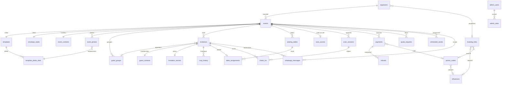

# 07 — Schéma backend Convivia (Supabase)

> Où vivent les données et qui peut les voir. Pour chaque table : colonnes,
> types, relations et règles d'accès (Row Level Security), avec le risque que
> chaque règle évite. Sources amont : `01-prd.md`, `02-app-flow.md`,
> `06-trd.md`. Rédigé le **2026-10-20**.
>
> **Ce document ne crée rien dans la base.** Les migrations seront écrites à
> partir de lui dans les tranches du `08-plan-implementation.md`.

---

## 0. Décisions prises pendant la rédaction

| # | Sujet | Décision |
|---|---|---|
| S1 | Influenceurs | **Fiche influenceur seule** : rattachement de codes promo et de liens de suivi. **Aucun versement** enregistré dans Convivia (hors application) |
| S2 | Coordonnées des organisateurs côté admin | **Super-admin et support** : nom, e-mail, numéro complets. **Finance** : nom + e-mail, numéro masqué. **Marketing** : agrégats seulement. **Contenu** : rien |
| S3 | Écritures du support | **Lecture seule + notes internes** (`support_notes`). Le **super-admin** peut **suspendre** un compte organisateur, tracé dans `audit_log` |
| S4 | Suppression d'un événement ou d'un compte payé | Données personnelles **effacées** ; `payments`, `refunds`, coûts WhatsApp et `event_stats_snapshots` **conservés** avec une copie figée non personnelle ; `trial_claims` garde l'**empreinte** du numéro |
| S5 | Famille / regroupement des invités | **Groupes libres** créés par l'organisateur (`guest_groups`), **pour tous les types** d'événement ; une invitation appartient à **au plus un groupe** |
| S6 | Invité sans QR le jour J | L'équipe d'accueil **ne voit jamais la liste des invités**. L'organisateur peut **afficher le QR d'un invité** depuis son espace |
| S7 | Événements statistiques | Table **`analytics_events`** écrite par le serveur seul, **sans donnée personnelle**, lue par marketing et super-admin **via des vues d'agrégats** |
| S8 | Doublon de numéro dans un événement | **Autorisé** : pas de contrainte d'unicité sur (`event_id`, `phone_e164`), un couple peut partager un numéro |
| S9 | Effet de la suspension | Lecture conservée ; **aucune écriture, aucun envoi** (§ 1.2, règle 6) |
| S10 | Remboursements vus par l'organisateur | Montant, statut et date de **ses** remboursements, **sans** le motif interne (§ 8.4) |
| S11 | Code d'accueil réaffichable | Stocké **haché et chiffré** (§ 7.1), pour respecter « Générer / afficher » (02 § 1.16) |
| S12 | Images des QR codes | Bucket **privé** `qr-codes`, servi par URL signée de courte durée (§ 15.1) |
| S13 | Type d'événement | **Figé après le premier envoi** (§ 4.1) |

---

## 1. Principes d'accès

### 1.1 Les acteurs

| Abrév. | Acteur | Comment il atteint la base |
|---|---|---|
| **anon** | Visiteur non connecté | Clé publique, rôle Postgres `anon`. **Aucune politique** ne lui ouvre une table métier |
| **O** | Organisateur **propriétaire** de l'événement | Rôle `authenticated`, `auth.uid()` = `organizers.id` |
| **I** | Invité (sans compte) | **Jamais en direct.** Routes serveur `/i/<token>` → fonctions `SECURITY DEFINER` (`get_guest_view`, `submit_rsvp`, `mark_opened`) |
| **A** | Équipe d'accueil (sans compte) | **Jamais en direct sur les tables.** Routes serveur `/scan/*` → fonction `check_in`. Pour le temps réel seulement : jeton Realtime court au rôle `scanner` (§ 15.2) |
| **SA** | Super-admin | `authenticated` + `aal2` + rôle `super_admin` dans `admin_roles` |
| **MKT** | Marketing | idem, rôle `marketing` |
| **FIN** | Finance | idem, rôle `finance` |
| **SUP** | Support client | idem, rôle `support` |
| **CNT** | Contenu | idem, rôle `content` |
| **SRV** | Serveur | Clé de service (`service_role`), webhooks, `pg_cron`, Edge Functions. Contourne RLS : réservé au code serveur (TRD § 8.3) |

### 1.2 Règles transverses

1. **RLS activé sur toutes les tables, refus par défaut.** Sans politique
   explicite, personne d'autre que le serveur ne lit ni n'écrit.
   *Risque évité : une table oubliée devient lisible par n'importe qui avec la
   clé publique, qui est visible dans le navigateur.*
2. **Les admins ne lisent pas les tables brutes quand une colonne doit leur
   rester cachée.** RLS filtre des lignes, pas des colonnes. Les écrans admin
   lisent des **vues `admin_*_v`** (§ 14) qui exposent seulement les colonnes
   autorisées et vérifient le rôle dans leur `WHERE`.
   *Risque évité : un admin finance qui interroge directement `organizers`
   récupérerait les numéros complets que S2 lui interdit.*
3. **`aal2` obligatoire** dans toutes les politiques et vues admin
   (`auth.jwt() ->> 'aal' = 'aal2'`).
   *Risque évité : un mot de passe admin volé ne suffit pas sans le second
   facteur TOTP.*
4. **Écritures critiques par fonctions seulement** (`add_guest`,
   `confirm_payment`, `check_in`, `record_refund`…), `SECURITY DEFINER`,
   `search_path` fixé, droits d'exécution accordés au strict nécessaire.
   *Risque évité : un client qui écrit directement dans une table contournerait
   le plafond d'invités, le quota de messages ou les règles d'entrée.*
5. **Aucune politique admin sur `guest_contacts`**, super-admin compris, et
   aucune vue admin ne la joint (PRD § 4).
   *Risque évité : fuite des noms et numéros des invités vers le pilotage, qui
   n'en a pas besoin.*
6. **Organisateur suspendu** (S3) : il garde la **lecture** de ses données,
   mais toutes ses politiques d'**écriture** et tous les envois exigent
   `organizers.status = 'active'`.
   *Risque évité : un compte suspendu pour spam continuerait d'envoyer depuis
   le numéro Convivia partagé et dégraderait sa note de qualité Meta.*
7. **Identifiants stables après suppression (S4).** Les tables conservées
   portent `event_ref uuid` / `organizer_ref uuid` : une **copie** de
   l'identifiant, **sans clé étrangère**, à côté d'un `event_id` à clé
   étrangère `ON DELETE SET NULL`.
   *Risque évité : perdre l'historique comptable en supprimant un événement,
   ou au contraire garder un lien vers des données personnelles effacées.*
8. **Droits accordés explicitement** (décision du 2026-10-21, migration
   `20261021140600_revoke_default_privileges_public`). Les privilèges par
   défaut du schéma `public` sont retirés à `anon` et `authenticated`, et
   `EXECUTE` est retiré à `PUBLIC`. Chaque nouvelle table, vue ou fonction
   appelable accorde donc ses droits **explicitement** dans sa migration
   (`GRANT` au strict nécessaire, en plus des politiques RLS). La lecture
   des pays et des paliers de prix actifs par `anon` vient du `GRANT SELECT`
   explicite de `20261021140500_anon_read_countries_and_pricing_tiers`,
   filtré par RLS sur `is_active`. Les en-têtes de `20261021140100` et
   `20261021140300`, qui l'attribuent aux privilèges par défaut, sont
   dépassés et ne sont pas réécrits, car une migration appliquée ne se
   modifie pas. Limite : les objets créés par `supabase_admin`, et le
   schéma `storage`, gardent les privilèges par défaut de la plateforme
   (voir § 15.1).
   *Risque évité : une table ou une fonction ajoutée plus tard serait
   ouverte à la clé publique par simple oubli.*

### 1.3 Fonctions d'aide (schéma `private`, non exposé à l'API)

| Fonction | Renvoie vrai si |
|---|---|
| `private.is_event_owner(event_id uuid)` | l'événement appartient à `auth.uid()` |
| `private.is_active_owner(event_id uuid)` | idem **et** `organizers.status = 'active'` |
| `private.has_admin_role(r admin_role)` | jeton `aal2` **et** ligne `(auth.uid(), r)` dans `admin_roles` **et** `admin_users.is_active` |
| `private.has_any_admin_role(r admin_role[])` | au moins un des rôles, mêmes conditions |
| `private.has_permission(p text)` | un des rôles de l'utilisateur porte la permission `p` dans `admin_role_permissions` (§ 2.4) |
| `private.is_over_cap(invitation_id uuid)` | l'invitation est **en excédent** (TRD D26, D37) : non envoyée (`sent_at` nul), événement en `billing_status = 'paid'`, et le cumul des `seats` des invitations non envoyées, dans l'ordre (`created_at`, `id`), dépasse `guest_cap` − places des invitations déjà envoyées. Une invitation envoyée n'est jamais en excédent |

Le schéma `private` n'est pas exposé par PostgREST.
*Risque évité : un client ne peut pas appeler ces fonctions pour sonder qui
est admin ou propriétaire de quel événement.*

### 1.4 Types énumérés

| Type | Valeurs |
|---|---|
| `event_type` | `wedding`, `dowry`, `baptism`, `birthday`, `baby_presentation`, `other` |
| `organizer_status` | `active`, `suspended` |
| `admin_role` | `super_admin`, `marketing`, `finance`, `support`, `content` |
| `billing_status` | `unpaid` (brouillon), `trial`, `paid` |
| `table_naming` | `named`, `numbered` |
| `invitation_kind` | `single`, `plus_one` |
| `rsvp_status` | `pending`, `accepted`, `declined` |
| `rsvp_source` | `guest`, `check_in` |
| `check_in_who` | `both`, `main`, `companion` |
| `check_in_result` | `admitted`, `partial` (1/2), `already_in`, `refused_main_absent`, `refused_strict`, `refused_other_event`, `invalid` |
| `payment_kind` | `initial`, `upgrade`, `extra_seats`, `quote` |
| `payment_status` | `pending`, `approved`, `declined`, `canceled` |
| `refund_mode` | `fedapay_dashboard`, `manual_transfer` |
| `refund_status` | `recorded`, `executed` |
| `quote_status` | `pending`, `quoted`, `paid`, `canceled` |
| `wa_category` | `marketing`, `utility`, `authentication`, `service` |
| `wa_purpose` | `invitation`, `invitation_resend` (D28), `ticket`, `reminder_auto`, `reminder_manual`, `event_update`, `thank_you`, `host_message`, `login_code`, `auto_reply` |
| `wa_status` | `queued`, `sending`, `sent`, `delivered`, `read`, `failed`, `canceled` |
| `schedule_kind` | `bulk_send`, `reminder_auto`, `event_update` |
| `schedule_status` | `pending`, `done`, `canceled` |
| `promo_kind` | `percent`, `fixed`, `tracking_only` |
| `optout_source` | `button`, `stop_reply`, `blocked` |

### 1.5 Conventions de colonnes

- Clés primaires `uuid` (`gen_random_uuid()`), sauf mention contraire.
- Montants en **`integer` FCFA** (devise `XOF`), jamais de décimales (TRD § 1.3).
  Exception : les **tarifs Meta** en dollars, stockés en **micro-dollars**
  (`bigint`, 1 $ = 1 000 000) pour rester en entiers.
- Dates en `timestamptz` (UTC) ; fuseau de l'événement dans `events.timezone`.
- Numéros en **E.164** (`text`, contrôle `^\+[1-9][0-9]{7,14}$`).
- Empreintes de numéro : `phone_hash text` = HMAC-SHA256(E.164,
  `OPTOUT_HASH_SECRET`), en hexadécimal.
- `created_at timestamptz not null default now()` partout ; `updated_at`
  maintenu par un déclencheur là où la ligne est modifiable.

---

## 2. Comptes, administration, rôles

### 2.1 `organizers`

Profil de l'organisateur, une ligne par compte `auth.users` (créée à la
première vérification de code).

| Colonne | Type | Contraintes / notes |
|---|---|---|
| `id` | `uuid` | PK, FK → `auth.users.id` `ON DELETE CASCADE` |
| `full_name` | `text` | saisi à la première connexion avec `city` et `country_code` (TRD D44) ; signe « De la part de [organisateur] » |
| `email` | `text` | copie de `auth.users.email`, peut être nul |
| `phone_e164` | `text` | numéro WhatsApp, peut être nul (compte e-mail) |
| `phone_verified_at` | `timestamptz` | renseigné après code (TRD § 7.3) |
| `country_code` | `char(2)` | FK → `countries.code` |
| `city` | `text` | sert la répartition par ville |
| `acquisition_link_id` | `uuid` | FK → `tracking_links.id` `ON DELETE SET NULL` ; **définitif** à l'inscription (D19) |
| `posthog_distinct_id` | `text` | lien visiteur ↔ inscrit (TRD § 13.1) |
| `status` | `organizer_status` | défaut `active` |
| `suspended_at`, `suspended_by` | `timestamptz`, `uuid` | `suspended_by` FK → `admin_users.user_id` |
| `suspension_reason` | `text` | |
| `created_at`, `updated_at` | `timestamptz` | |

**Relations** : 1 organisateur → N `events`, N `payments`.

| Qui | Droit | Risque évité |
|---|---|---|
| O | `SELECT` / `UPDATE` de **sa** ligne (`id = auth.uid()`) ; `UPDATE` limité à `full_name`, `city`, `country_code` (colonnes accordées par `GRANT UPDATE (…)`) | Un organisateur ne peut ni lire le profil d'un autre, ni changer lui-même son statut de suspension ou son canal d'acquisition. |
| SRV | `INSERT` à l'inscription ; mise à jour de `email`, `phone_*`, `acquisition_link_id` | Le canal d'acquisition et le numéro vérifié ne viennent que du flux d'authentification, pas d'une saisie libre. |
| SA, SUP | Lecture complète via `admin_organizers_support_v` | Le support retrouve un compte pour aider, sans accès direct à la table brute. |
| FIN | Lecture via `admin_organizers_finance_v` : nom, e-mail, **numéro masqué** | La comptabilité identifie le payeur sans disposer de numéros exploitables. |
| SA | `UPDATE` de `status`, `suspended_*` via `suspend_organizer()` / `reactivate_organizer()` (journalisées) | Une suspension ne peut pas être faite en silence ni par un autre rôle. |
| **Ne voit jamais** | MKT (seulement des agrégats ville/pays/canal), CNT, anon, I, A | — |

**`login_attempts`** (TRD D24) : compteur des codes de connexion faux, indexé
par l'**empreinte** HMAC de l'e-mail ou du numéro (le compte peut ne pas
exister encore, D23). Colonnes : `identifier_hash` (PK), `failed_count`,
`locked_until`, `updated_at`. Lecture et écriture par le serveur seulement ;
purge des lignes inactives depuis plus de 48 h. *Risque évité : deviner un
code par essais répétés, sans révéler si un compte existe.*

### 2.2 `admin_users`

| Colonne | Type | Contraintes / notes |
|---|---|---|
| `user_id` | `uuid` | PK, FK → `auth.users.id` |
| `full_name` | `text` | |
| `email` | `text` | unique |
| `is_active` | `boolean` | défaut `true` ; `false` = accès coupé immédiatement |
| `created_by` | `uuid` | FK → `admin_users.user_id` |
| `last_login_at` | `timestamptz` | |
| `failed_logins` | `smallint` | défaut 0 ; remis à 0 après une connexion réussie (D33) |
| `locked_until` | `timestamptz` | blocage de 15 min après 5 échecs, mot de passe et TOTP confondus (D33) |
| `created_at` | `timestamptz` | |

Règles d'accès D33 (TRD § 8.1) : codes de secours TOTP stockés **hachés**
dans `admin_recovery_codes(user_id, code_hash, used_at)` (10 par admin, usage
unique, lecture et écriture par le serveur seulement) ; réinitialisation du
TOTP par `reset_admin_mfa(user_id, reason)`, réservée au super-admin et
journalisée ; chaque blocage est inscrit dans `audit_log`. Le détail des
tables est à finaliser par le `supabase-developer` à la tranche concernée.

Un compte admin **n'a pas** de ligne `organizers` (TRD § 8.1). Contrainte :
un déclencheur refuse la création d'une ligne `organizers` pour un
`user_id` présent ici, et inversement.

| Qui | Droit | Risque évité |
|---|---|---|
| Tout admin (`aal2`) | `SELECT` de **sa** ligne | Un admin voit son propre compte sans pouvoir lister les autres admins. |
| SA | `SELECT` de toutes ; `INSERT` / `UPDATE` via `create_admin()` / `deactivate_admin()` (journalisées) | Seul le super-admin crée des comptes admin, sans inscription publique possible. |
| **Ne voit jamais** | MKT, FIN, SUP, CNT (au-delà de leur ligne), organisateurs, anon | — |

### 2.3 `admin_roles`

| Colonne | Type | Contraintes / notes |
|---|---|---|
| `user_id` | `uuid` | FK → `admin_users.user_id` `ON DELETE CASCADE` |
| `role` | `admin_role` | |
| `granted_by` | `uuid` | FK → `admin_users.user_id` |
| `granted_at` | `timestamptz` | |
| | | PK (`user_id`, `role`) : cumul de rôles possible |

Garde-fous dans `grant_admin_role()` / `revoke_admin_role()` : un admin ne
peut pas modifier **ses propres** rôles ; le **dernier** super-admin actif ne
peut pas être retiré.

| Qui | Droit | Risque évité |
|---|---|---|
| Tout admin (`aal2`) | `SELECT` de **ses** rôles (affichage du menu) | Un admin ne découvre pas les rôles des autres. |
| SA | Lecture de tout ; écriture **uniquement** par les deux fonctions, journalisées | Pas d'auto-promotion, pas de plateforme sans super-admin, chaque changement de droit est traçable. |
| **Ne voit jamais** | Organisateurs, anon, I, A | — |

### 2.4 `admin_role_permissions`

Matrice de la TRD § 8.2 sous forme de données, lue par
`private.has_permission()`.

| Colonne | Type | Contraintes / notes |
|---|---|---|
| `role` | `admin_role` | |
| `permission` | `text` | ex. `refunds.create`, `promos.configure`, `payments.read_status`, `templates.write`, `pricing.write`, `quotes.price`, `organizers.suspend`, `exports.finance` |
| | | PK (`role`, `permission`) |

| Qui | Droit | Risque évité |
|---|---|---|
| Tout admin (`aal2`) | `SELECT` | L'interface masque les boutons non autorisés sans coder la matrice deux fois. |
| Personne (pas même SA) | Écriture **seulement par migration** versionnée | Un admin compromis ne peut pas s'accorder la permission de rembourser ou d'exporter en modifiant la matrice. |
| **Ne voit jamais** | Organisateurs, anon | — |

### 2.5 `audit_log`

Journal **en ajout seul** (TRD § 8.4).

| Colonne | Type | Contraintes / notes |
|---|---|---|
| `id` | `bigint` | PK identité |
| `occurred_at` | `timestamptz` | |
| `actor_id` | `uuid` | admin ou organisateur ; nul si système |
| `actor_kind` | `text` | `admin`, `organizer`, `system` |
| `action` | `text` | ex. `admin.login`, `role.grant`, `pricing.update`, `quote.priced`, `refund.recorded`, `refund.executed`, `export.finance`, `organizer.suspended`, `admin.deactivated` |
| `target_table`, `target_id` | `text`, `uuid` | |
| `details` | `jsonb` | montant, motif, référence… **jamais** de coordonnées d'invité |
| `ip_hash` | `text` | |

Un déclencheur `BEFORE UPDATE OR DELETE` lève une erreur sur cette table.

| Qui | Droit | Risque évité |
|---|---|---|
| SRV / fonctions | `INSERT` seulement | Personne ne peut écrire une entrée d'audit arbitraire depuis le navigateur. |
| SA | `SELECT` | Le super-admin contrôle les actes sensibles de tous les rôles. |
| Personne | `UPDATE`, `DELETE` (déclencheur bloquant) | Un admin ne peut pas effacer la trace d'un remboursement ou d'un export. |
| **Ne voit jamais** | MKT, FIN, SUP, CNT, organisateurs, anon | — |

### 2.6 `support_notes` (S3)

| Colonne | Type | Contraintes / notes |
|---|---|---|
| `id` | `uuid` | PK |
| `organizer_id` | `uuid` | FK → `organizers.id` `ON DELETE CASCADE` |
| `event_id` | `uuid` | FK → `events.id` `ON DELETE SET NULL`, facultatif |
| `author_id` | `uuid` | FK → `admin_users.user_id` |
| `body` | `text` | contrôle : longueur ≤ 2 000 |
| `created_at` | `timestamptz` | |

Pas de modification : une note corrigée = une nouvelle note.

| Qui | Droit | Risque évité |
|---|---|---|
| SUP, SA | `SELECT`, `INSERT` (`author_id = auth.uid()`) | L'historique d'assistance est partagé, et personne ne signe une note au nom d'un autre. |
| Personne | `UPDATE`, `DELETE` | Une note gênante ne peut pas être réécrite après coup. |
| **Ne voit jamais** | L'organisateur concerné, MKT, FIN, CNT, anon | Notes internes : leur divulgation à l'organisateur ou au marketing n'a pas d'utilité. |

> Consigne d'usage : ne jamais recopier dans une note le nom ou le numéro d'un
> invité transmis par l'organisateur.

---

## 3. Réglages plateforme et catalogue

### 3.1 `countries`

| Colonne | Type | Contraintes / notes |
|---|---|---|
| `code` | `char(2)` | PK (`BJ`, `CI`, `TG`, `SN`) |
| `name` | `text` | |
| `timezone` | `text` | `Africa/Porto-Novo`, `Africa/Abidjan`, `Africa/Lome`, `Africa/Dakar` |
| `dial_code` | `text` | `+229`… |
| `is_active` | `boolean` | pays ouvert à l'inscription |

| Qui | Droit | Risque évité |
|---|---|---|
| anon, O, admins | `SELECT` des pays actifs | Donnée publique nécessaire aux formulaires. |
| SA | Écriture | Ouvrir un pays non couvert par FedaPay doit rester une décision du super-admin. |

### 3.2 `platform_settings`

Clé / valeur : limite d'envoi Meta courante, note de qualité, seuils d'alerte.

| Colonne | Type | Contraintes / notes |
|---|---|---|
| `key` | `text` | PK |
| `value` | `jsonb` | |
| `updated_by`, `updated_at` | `uuid`, `timestamptz` | |

| Qui | Droit | Risque évité |
|---|---|---|
| SA | Lecture, écriture (journalisée) | Un réglage qui agit sur tous les envois ne se change pas sans trace. |
| SRV | Lecture, écriture (mise à jour de la limite Meta) | Le dispatcher connaît la limite réelle sans dépendre d'une saisie humaine. |
| **Ne voit jamais** | Autres admins, organisateurs, anon | — |

### 3.3 `templates`

| Colonne | Type | Contraintes / notes |
|---|---|---|
| `id` | `uuid` | PK |
| `event_type` | `event_type` | |
| `slug` | `text` | unique, ex. `wedding-royal` |
| `name` | `text` | |
| `palette` | `jsonb` | couleurs de la palette (pilote l'enveloppe, 05 § 2) |
| `fonts` | `jsonb` | |
| `layout_version` | `integer` | version du rendu dans le code |
| `preview_path` | `text` | chemin dans le bucket `template-assets` |
| `og_background_path` | `text` | fond de l'image Open Graph (TRD § 11.4) |
| `is_active` | `boolean` | |
| `sort_order` | `smallint` | |
| `updated_by`, `updated_at` | `uuid`, `timestamptz` | |

Contrainte : au plus 2 templates actifs par `event_type` (PRD § 6.3),
vérifiée par déclencheur.

### 3.4 `template_photo_slots`

| Colonne | Type | Contraintes / notes |
|---|---|---|
| `id` | `uuid` | PK |
| `template_id` | `uuid` | FK → `templates.id` `ON DELETE RESTRICT` |
| `slot_key` | `text` | unique par template, ex. `hero`, `gallery_1` |
| `label` | `text` | libellé affiché à l'organisateur |
| `aspect_ratio` | `text` | `4:5`, `1:1`, `3:2` (TRD § 9) |
| `position` | `smallint` | |
| `is_required` | `boolean` | |

### 3.5 `envelope_styles`

| Colonne | Type | Contraintes / notes |
|---|---|---|
| `id` | `uuid` | PK |
| `slug` | `text` | unique |
| `name` | `text` | |
| `config` | `jsonb` | paramètres d'animation CSS/SVG (D21) |
| `preview_path` | `text` | |
| `is_active` | `boolean` | |
| `sort_order` | `smallint` | |

**Accès communs à `templates`, `template_photo_slots`, `envelope_styles`** :

| Qui | Droit | Risque évité |
|---|---|---|
| anon, O | `SELECT` des lignes actives | Le catalogue est public (vitrine, choix du design) ; les brouillons du rôle contenu ne fuitent pas. |
| CNT, SA | `SELECT` de tout, `INSERT`, `UPDATE` | Seuls les rôles prévus par le PRD modifient le catalogue. |
| Personne | `DELETE` d'un template ou d'un style utilisé (`ON DELETE RESTRICT`) — on le désactive | Supprimer un template casserait le mini-site d'événements déjà envoyés. |
| **Ne voit jamais** | — (catalogue non sensible) | — |

---

## 4. Événements et contenus

### 4.1 `events`

| Colonne | Type | Contraintes / notes |
|---|---|---|
| `id` | `uuid` | PK |
| `organizer_id` | `uuid` | FK → `organizers.id` `ON DELETE CASCADE` |
| `type` | `event_type` | non modifiable après le premier envoi |
| `name` | `text` | |
| `hosts` | `text` | hôtes / parents (02 § 1.6) |
| `starts_at` | `timestamptz` | modifiable à tout moment (PRD § 7.9) |
| `timezone` | `text` | déduit de `country_code` |
| `country_code` | `char(2)` | **non nul**, FK → `countries.code` ; obligatoire à la création (D25) |
| `city` | `text` | |
| `venue_name`, `venue_address` | `text` | |
| `venue_map_url` | `text` | facultatif |
| `template_id` | `uuid` | FK → `templates.id`, doit être du même `type` |
| `envelope_style_id` | `uuid` | FK → `envelope_styles.id` |
| `billing_status` | `billing_status` | défaut `unpaid` ; écrit par fonctions seulement |
| `guest_cap` | `integer` | plafond = places payées + `trial_bonus_seats` (TRD D27), ou `trial_bonus_seats` seul pendant l'essai ; `0` en brouillon, y compris après un remboursement total (D35) ; écrit par fonctions seulement |
| `trial_bonus_seats` | `smallint` | `0` ou `10` : bonus fixe de l'essai, conservé après un paiement et après un remboursement (D27, D35) ; écrit par `claim_trial()` seulement |
| `seats_used` | `integer` | décompte (« +1 » = 2), tenu par `add_guest` / `update_guest` / `delete_guest` |
| `unit_price_locked` | `integer` | prix unitaire du palier payé (TRD § 3.2) |
| `paid_seats` | `integer` | places payées restantes après remboursements ; base de la « valeur déjà acquise » d'un nouveau paiement (TRD D40) ; écrit par `confirm_payment()` / `mark_refund_executed()` seulement |
| `current_tier_id` | `uuid` | FK → `pricing_tiers.id` |
| `attributed_promo_id` | `uuid` | FK → `promo_codes.id` `ON DELETE SET NULL` (D19) |
| `table_naming` | `table_naming` | défaut `numbered` |
| `strict_entry_mode` | `boolean` | défaut `false` (PRD § 7.8) |
| `reminders_enabled` | `boolean` | défaut `true` |
| `first_sent_at` | `timestamptz` | premier envoi d'invitations |
| `rsvp_closed_at` | `timestamptz` | clôture des RSVP (PRD § 7.6) |
| `created_at`, `updated_at` | `timestamptz` | |

L'état affiché sur le tableau de bord est **calculé**, pas stocké : brouillon
(`unpaid`), essai, payé, programmé (un `bulk_send` en attente), envoyé
(`first_sent_at`), clôturé (`rsvp_closed_at`), passé (`starts_at` dépassé).

**Relations** : 1 événement → 1 `event_contents`, N `event_photos`,
N `guest_groups`, N `invitations`, N `seating_tables`, 1 `scan_access`,
N `scan_sessions`, N `check_ins`, N `payments`, N `scheduled_sends`,
N `whatsapp_messages`.

| Qui | Droit | Risque évité |
|---|---|---|
| O | `SELECT` de ses événements (`private.is_event_owner(id)`) | Un organisateur ne voit pas les événements des autres, même en devinant un identifiant. |
| O actif | `INSERT` avec `organizer_id = auth.uid()` | Impossible de créer un événement au nom d'un autre compte. |
| O actif | `UPDATE` des colonnes de contenu (`name`, `hosts`, `starts_at`, lieu, `template_id`, `envelope_style_id`, `table_naming`, `strict_entry_mode`, `reminders_enabled`) via `GRANT UPDATE (…)` ; `country_code` (et `timezone` recalculé) modifiable via `update_event_country()` **tant que `first_sent_at` est nul** (TRD D39) ; l'heure locale est conservée : `starts_at` et les `scheduled_sends.run_at` en attente sont recalculés dans le nouveau fuseau, dans la même transaction (D41) | Les colonnes de facturation (`billing_status`, `guest_cap`, `seats_used`, prix) ne sont jamais modifiables depuis le navigateur : personne ne se débloque l'envoi sans payer. |
| O actif | Clôture des RSVP via `close_rsvp(event_id)` | La clôture est irréversible et horodatée par la base, pas par le client. |
| O | `DELETE` via `delete_event(event_id)` (§ 16) | La suppression passe par la fonction qui conserve la comptabilité (S4) au lieu d'un `DELETE` en cascade aveugle. |
| SRV | Écriture de `billing_status`, `guest_cap`, `seats_used`, `first_sent_at`, prix | Seul le serveur, après paiement confirmé ou essai validé, modifie le droit d'envoyer. |
| SUP, SA | Lecture via `admin_events_v` (nom, type, date, ville, pays, statut, compteurs RSVP/envoi, statut de paiement) | L'assistance voit l'état d'un événement sans accéder à la liste des invités. |
| FIN | Lecture via `admin_events_v` (mêmes colonnes) et vues finance | La finance relie un paiement à son événement. |
| MKT | Agrégats seulement (`admin_usage_v`, `admin_funnel_v`) : type, ville, pays, dates | Le marketing mesure la croissance sans parcourir les événements privés un par un. |
| **Ne voit jamais** | CNT, anon, autres organisateurs. I et A n'obtiennent que les champs renvoyés par `get_guest_view` / `check_in` | — |

### 4.2 `event_contents`

| Colonne | Type | Contraintes / notes |
|---|---|---|
| `event_id` | `uuid` | PK, FK → `events.id` `ON DELETE CASCADE` |
| `invitation_message` | `text` | |
| `program` | `jsonb` | liste `[{time, label}]` |
| `practical_info` | `text` | |
| `dress_code` | `text` | |
| `type_fields` | `jsonb` | champs spécifiques au type, validés par l'application |
| `updated_at` | `timestamptz` | invalide le cache `event:<id>` (TRD § 11.1) |

| Qui | Droit | Risque évité |
|---|---|---|
| O | `SELECT` ; O actif : `INSERT`, `UPDATE` | Le contenu d'une invitation n'est lisible et modifiable que par son auteur. |
| I | Lecture via `get_guest_view(token)` | L'invité lit le contenu de **son** événement, sans pouvoir énumérer les autres. |
| SUP, SA | Lecture via `admin_event_content_v` | Le support peut constater un problème d'affichage signalé par l'organisateur. |
| **Ne voit jamais** | MKT, FIN, CNT, anon, A | Le texte d'invitation contient souvent des noms de famille : il ne sert pas au pilotage. |

### 4.3 `event_photos`

| Colonne | Type | Contraintes / notes |
|---|---|---|
| `id` | `uuid` | PK |
| `event_id` | `uuid` | FK → `events.id` `ON DELETE CASCADE` |
| `slot_id` | `uuid` | FK → `template_photo_slots.id` |
| `storage_prefix` | `text` | `<event_id>/<uuid aléatoire>/` dans `event-photos` |
| `crop` | `jsonb` | coordonnées de recadrage |
| `variants` | `jsonb` | liste des variantes générées (480/960/1440, WebP/AVIF) |
| `bytes_total` | `bigint` | coût de stockage (TRD § 13.4) |
| `created_at` | `timestamptz` | |
| | | unique (`event_id`, `slot_id`) |

| Qui | Droit | Risque évité |
|---|---|---|
| O | `SELECT` ; O actif : `INSERT`, `UPDATE`, `DELETE` | Personne ne remplace les photos de l'événement d'un autre. |
| I | Chemins renvoyés par `get_guest_view` | L'invité n'obtient que les photos de son événement. |
| FIN, SA | `bytes_total` agrégé dans `admin_margins_v` | La marge intègre le coût de stockage sans exposer les images. |
| **Ne voit jamais** | MKT, SUP, CNT, anon, A (lignes de la table) | — |

---

## 5. Invités

### 5.1 `guest_groups` (S5)

| Colonne | Type | Contraintes / notes |
|---|---|---|
| `id` | `uuid` | PK |
| `event_id` | `uuid` | FK → `events.id` `ON DELETE CASCADE` |
| `name` | `text` | ex. « Famille Adjovi », « Côté mariée », « Collègues » ; unique par événement |
| `sort_order` | `smallint` | |
| `created_at` | `timestamptz` | |

| Qui | Droit | Risque évité |
|---|---|---|
| O | `SELECT` ; O actif : `INSERT`, `UPDATE`, `DELETE` | Les groupes révèlent l'organisation familiale : seul l'organisateur les voit. |
| **Ne voit jamais** | Tous les admins, anon, I, A | Un nom de groupe est souvent un nom de famille, donc une donnée personnelle. |

### 5.2 `invitations`

Une ligne par invitation (une personne, ou « Nom + 1 »). **Ni nom, ni numéro,
ni jeton ici.**

| Colonne | Type | Contraintes / notes |
|---|---|---|
| `id` | `uuid` | PK |
| `event_id` | `uuid` | FK → `events.id` `ON DELETE CASCADE` |
| `kind` | `invitation_kind` | |
| `seats` | `smallint` | colonne générée : 2 si `plus_one`, sinon 1 |
| `group_id` | `uuid` | FK → `guest_groups.id` `ON DELETE SET NULL` |
| `rsvp_status` | `rsvp_status` | défaut `pending` |
| `rsvp_answered_at` | `timestamptz` | |
| `sent_at` | `timestamptz` | premier message `invitation` envoyé |
| `opened_at` | `timestamptz` | après l'animation d'enveloppe (TRD § 11.2) |
| `main_checked_in_at` | `timestamptz` | |
| `companion_checked_in_at` | `timestamptz` | |
| `manual_messages_used` | `smallint` | défaut 0, contrôle `0..3` (D4) |
| `free_resend_used` | `boolean` | défaut `false` ; vrai après le renvoi gratuit (D28) |
| `auto_reminders_sent` | `smallint` | défaut 0, contrôle `0..2` (D3) |
| `created_at`, `updated_at` | `timestamptz` | |

| Qui | Droit | Risque évité |
|---|---|---|
| O | `SELECT` | L'organisateur suit ses invitations ; aucun autre compte ne voit leur état. |
| O actif | Écriture **uniquement** via `add_guest()`, `update_guest()`, `delete_guest()` ; aucune politique `INSERT/UPDATE/DELETE` directe | Les règles du plafond sont vérifiées sous verrou (TRD § 3.2) : pendant l'essai seul, `seats_used + seats ≤ 10` ; après paiement, ajout libre mais les invités **en excédent** (`private.is_over_cap(invitation_id)`, § 1.3 ; jamais une invitation déjà envoyée) sont « en attente de paiement » et exclus de tout envoi (TRD D26, D37). `update_guest()` refuse de changer `kind` une fois `sent_at` renseigné (D32). |
| O | **Jamais** d'écriture sur `rsvp_status`, `opened_at`, `*_checked_in_at`, compteurs | L'organisateur ne peut pas maquiller les statistiques ni faire entrer un invité sans scan. |
| I | `submit_rsvp(token, status)` refusée si `rsvp_closed_at` est renseigné ; `mark_opened(token)` | L'invité ne modifie que **sa** réponse, et plus rien après la clôture (PRD § 7.6). |
| A | `check_in()` met à jour `*_checked_in_at` et peut passer `rsvp_status` à `accepted` (D15) | Les entrées ne s'écrivent que par la règle centrale, sous verrou de ligne, sans double entrée possible. |
| SRV | Compteurs `sent_at`, `manual_messages_used`, `auto_reminders_sent`, `free_resend_used` dans la même transaction que la mise en file | Le quota de messages ne peut pas être contourné par deux clics simultanés. |
| SUP, SA, MKT, FIN | Compteurs **agrégés** par événement seulement (`admin_events_v`, `admin_usage_v`) | Le pilotage mesure ouvertures et présence sans lister les invitations. |
| **Ne voit jamais** | CNT, anon, autres organisateurs | — |

### 5.3 `guest_contacts`

Coordonnées, **séparées** de `invitations` (TRD § 8.3).

| Colonne | Type | Contraintes / notes |
|---|---|---|
| `invitation_id` | `uuid` | PK, FK → `invitations.id` `ON DELETE CASCADE` |
| `event_id` | `uuid` | FK → `events.id` `ON DELETE CASCADE` (dénormalisé pour RLS) |
| `full_name` | `text` | prénom + nom, pour l'affichage |
| `first_name` | `text` | **non nul** : prénom saisi (obligatoire, TRD D45), variable des messages WhatsApp |
| `last_name` | `text` | facultatif (D45) |
| `companion_name` | `text` | facultatif, seulement si `plus_one` |
| `phone_e164` | `text` | |
| `phone_hash` | `text` | HMAC, pour tester la liste d'exclusion sans relire le numéro |
| `consent_attested_at` | `timestamptz` | **non nul** : attestation obligatoire (PRD § 7.14) |
| `consent_attested_by` | `uuid` | FK → `organizers.id` |
| `updated_at` | `timestamptz` | |

| Qui | Droit | Risque évité |
|---|---|---|
| O | `SELECT` ; O actif : écriture via `add_guest()` / `update_guest()` (qui exigent l'attestation) | Seul l'organisateur, qui a fourni ces coordonnées, peut les lire ; aucun invité n'est ajouté sans consentement attesté et horodaté. |
| I | `get_guest_view` renvoie `full_name`, `first_name`, `companion_name` de **sa** ligne, **jamais** `phone_e164` | La page invité n'expose pas le numéro, même à l'invité (page transférable). |
| A | `check_in()` renvoie `first_name` seulement | L'équipe d'accueil salue l'invité sans voir son nom complet ni son numéro. |
| SRV | Lecture de `phone_e164` par le dispatcher au moment de l'envoi | Le numéro n'est recopié dans aucune autre table ni aucun journal. |
| **Ne voit jamais** | **SA, MKT, FIN, SUP, CNT** (aucune politique, aucune vue), anon, autres organisateurs | Respect de la règle transverse du PRD § 4 : les coordonnées servent l'organisateur, pas le pilotage. |

### 5.4 `invitation_secrets`

Jetons du lien personnel et du QR, isolés pour qu'**aucune** politique ne
puisse les exposer par erreur (TRD § 4 et § 5).

| Colonne | Type | Contraintes / notes |
|---|---|---|
| `invitation_id` | `uuid` | PK, FK → `invitations.id` `ON DELETE CASCADE` |
| `event_id` | `uuid` | FK → `events.id` `ON DELETE CASCADE` |
| `access_token` | `text` | unique, 128 bits base64url (22 car.), lien `/i/<token>` |
| `ticket_id` | `text` | unique, 128 bits base64url, distinct de `access_token` |
| `qr_image_path` | `text` | chemin aléatoire dans le bucket privé `qr-codes` |
| `created_at` | `timestamptz` | créé à l'envoi (D14) |

| Qui | Droit | Risque évité |
|---|---|---|
| SRV | Lecture, écriture | Le jeton reste côté serveur : il ne transite jamais par une réponse d'API listable. |
| O | **Aucune politique.** Lien et QR d'**un** invité obtenus via `get_invitation_link(invitation_id)` et `get_invitation_qr(invitation_id)`, qui vérifient la propriété (02 § 1.10 et S6). `get_invitation_link()` exige en plus (TRD D42) : invité dans la liste d'exclusion, `billing_status` `trial` ou `paid`, invitation non en excédent (`private.is_over_cap`) ; à la première copie, il crée les jetons s'ils n'existent pas et renseigne `sent_at` dans la même transaction (place occupée, type figé) | Un script dans le navigateur de l'organisateur ne peut pas aspirer tous les jetons d'un coup ; chaque demande est individuelle et contrôlée. |
| I | Résolution du jeton par la route serveur, 404 uniforme | On ne distingue pas un jeton inexistant d'un jeton supprimé : pas d'énumération. |
| A | Le QR contient `ticket_id` signé, jamais `access_token` | Photographier un QR à l'entrée ne donne pas accès à la page de l'invité. |
| **Ne voit jamais** | Tous les admins, anon, autres organisateurs | Avec un jeton, n'importe qui ouvre la page et répond à la place de l'invité. |

### 5.5 `rsvp_history`

Chaque changement de réponse, y compris le passage automatique à « présent »
au scan.

| Colonne | Type | Contraintes / notes |
|---|---|---|
| `id` | `bigint` | PK identité |
| `invitation_id` | `uuid` | FK → `invitations.id` `ON DELETE CASCADE` |
| `event_id` | `uuid` | FK → `events.id` `ON DELETE CASCADE` |
| `old_status`, `new_status` | `rsvp_status` | |
| `source` | `rsvp_source` | `guest` ou `check_in` (D15) |
| `changed_at` | `timestamptz` | |

Écrit par déclencheur sur `invitations.rsvp_status`. Ajout seul.

| Qui | Droit | Risque évité |
|---|---|---|
| O | `SELECT` | L'organisateur voit les changements d'avis (décliné puis confirmé). |
| SRV / déclencheur | `INSERT` seulement | L'historique ne peut pas être réécrit pour masquer une réponse. |
| SA, MKT | Agrégats (taux de changement d'avis) via `admin_usage_v` | Mesure de la qualité d'usage sans détail par invité. |
| **Ne voit jamais** | FIN, SUP, CNT (lignes), anon, A | — |

---

## 6. Tables et affectations

### 6.1 `seating_tables`

| Colonne | Type | Contraintes / notes |
|---|---|---|
| `id` | `uuid` | PK |
| `event_id` | `uuid` | FK → `events.id` `ON DELETE CASCADE` |
| `number` | `integer` | utilisé si `events.table_naming = 'numbered'` ; unique par événement |
| `name` | `text` | utilisé si `named` ; unique par événement |
| `capacity` | `smallint` | facultatif, indicatif (03 § 4.7) ; contrôle `> 0` ; non bloquant |
| `sort_order` | `smallint` | |
| `created_at` | `timestamptz` | |
| | | contrôle : `number` ou `name` renseigné |

### 6.2 `table_assignments`

| Colonne | Type | Contraintes / notes |
|---|---|---|
| `invitation_id` | `uuid` | PK (une table par invitation), FK → `invitations.id` `ON DELETE CASCADE` |
| `table_id` | `uuid` | FK → `seating_tables.id` `ON DELETE CASCADE` |
| `event_id` | `uuid` | FK → `events.id` ; contrôle : même événement que la table et l'invitation |
| `assigned_at` | `timestamptz` | |

**Accès communs aux deux tables** :

| Qui | Droit | Risque évité |
|---|---|---|
| O | `SELECT` ; O actif : `INSERT`, `UPDATE`, `DELETE` | Seul l'organisateur organise son plan de salle. |
| I | `get_guest_view` ne renvoie la table **que si** `main_checked_in_at` est renseigné (TRD § 6.5) | L'invité ne découvre pas sa table avant le scan, même en inspectant la page ou le réseau (PRD § 7.7). |
| A | `check_in()` renvoie le libellé de la table de l'invité scanné | L'équipe d'accueil oriente l'invité, sans accéder au plan complet. |
| **Ne voit jamais** | Tous les admins, anon, autres organisateurs ; I avant le scan | — |

---

## 7. Équipe d'accueil, scans et arrivées

### 7.1 `scan_access`

Code d'événement de 8 caractères (D12).

| Colonne | Type | Contraintes / notes |
|---|---|---|
| `event_id` | `uuid` | PK, FK → `events.id` `ON DELETE CASCADE` |
| `code_hash` | `text` | hachage lent (argon2id) du code, pour la vérification |
| `code_encrypted` | `text` | code chiffré (AES-256-GCM) avec la clé serveur `SCAN_CODE_ENCRYPTION_KEY`, pour le **réafficher** à l'organisateur (02 § 1.16) |
| `code_version` | `integer` | incrémenté à chaque régénération (révocation) |
| `generated_at` | `timestamptz` | |

La fenêtre d'activité (J-1 00:00 → J+1 23:59) est calculée depuis
`events.starts_at` et `events.timezone`, pas stockée.

| Qui | Droit | Risque évité |
|---|---|---|
| SRV | Lecture, écriture | Le code n'est jamais lisible par une requête du navigateur. |
| O actif | `generate_scan_code(event_id)`, `reveal_scan_code(event_id)` (fonctions vérifiant la propriété) | Seul l'organisateur obtient ou révoque le code de son événement. |
| **Ne voit jamais** | Tous les admins, A (qui le saisit sans pouvoir le lire en base), anon | Avec le code, n'importe qui scanne pour l'événement pendant la fenêtre. |

### 7.2 `scan_attempts`

Anti-essais : 5 codes faux → blocage 15 min.

| Colonne | Type | Contraintes / notes |
|---|---|---|
| `id` | `bigint` | PK identité |
| `ip_hash` | `text` | |
| `device_id` | `text` | identifiant aléatoire stocké sur l'appareil |
| `failed_count` | `smallint` | |
| `blocked_until` | `timestamptz` | |
| `updated_at` | `timestamptz` | |

Purge automatique des lignes de plus de 48 h.

| Qui | Droit | Risque évité |
|---|---|---|
| SRV | Seul accès | Un attaquant ne peut ni lire ni remettre à zéro son compteur d'essais. |
| **Ne voit jamais** | Tout le monde hors serveur | — |

### 7.3 `scan_sessions`

| Colonne | Type | Contraintes / notes |
|---|---|---|
| `id` | `uuid` | PK |
| `event_id` | `uuid` | FK → `events.id` `ON DELETE CASCADE` |
| `code_version` | `integer` | doit égaler `scan_access.code_version` à chaque scan |
| `device_label` | `text` | attribué automatiquement : « Appareil 1 », « Appareil 2 »… |
| `ip_hash` | `text` | |
| `created_at`, `expires_at` | `timestamptz` | session de 24 h |
| `revoked_at` | `timestamptz` | |

| Qui | Droit | Risque évité |
|---|---|---|
| SRV | Écriture à la saisie d'un code valide | Une session ne naît que d'un code valide dans sa fenêtre. |
| O | `SELECT` (nombre d'appareils connectés, libellés) | L'organisateur voit qui scanne et sait quand régénérer le code. |
| **Ne voit jamais** | Tous les admins, anon | — |

### 7.4 `check_ins`

Une ligne par **tentative** de scan traitée (acceptée ou refusée).

| Colonne | Type | Contraintes / notes |
|---|---|---|
| `id` | `uuid` | PK |
| `event_id` | `uuid` | FK → `events.id` `ON DELETE CASCADE` |
| `invitation_id` | `uuid` | FK → `invitations.id` `ON DELETE CASCADE` ; nul si QR invalide |
| `scan_session_id` | `uuid` | FK → `scan_sessions.id` |
| `who` | `check_in_who` | choix de l'équipe (D20) |
| `result` | `check_in_result` | |
| `people_admitted` | `smallint` | 0, 1 ou 2 |
| `prior_rsvp_status` | `rsvp_status` | pour la mention « n'avait pas confirmé / avait décliné » |
| `idempotency_key` | `text` | unique (TRD § 6.3) |
| `created_at` | `timestamptz` | |

| Qui | Droit | Risque évité |
|---|---|---|
| A | `INSERT` **uniquement** via `check_in(event_id, qr_payload, who, idempotency_key)` appelée par le serveur avec une session valide | Pas de double entrée, pas d'entrée d'un accompagnant sans l'invité principal, pas de scan pour un autre événement. |
| A | Compteurs et derniers arrivés (prénom + table) via `get_arrivals(event_id)` et le canal Realtime | L'écran live affiche les arrivées sans donner accès à la liste complète des invités (S6). |
| O | `SELECT` | L'organisateur suit les arrivées et les refus en direct. |
| Personne | `UPDATE`, `DELETE` | Une entrée enregistrée ne peut pas être effacée pour faire entrer quelqu'un une seconde fois. |
| SA, MKT | Agrégat « places entrées / places confirmées » via `admin_usage_v` | Mesure de la présence sans détail par invité. |
| **Ne voit jamais** | FIN, SUP, CNT (lignes), anon | — |

---

## 8. Forfaits, devis, paiements, remboursements, essais

### 8.1 `pricing_tiers`

| Colonne | Type | Contraintes / notes |
|---|---|---|
| `id` | `uuid` | PK |
| `seats` | `integer` | 50, 100, 200, 300, 500, 1 000 |
| `unit_price` | `integer` | FCFA ; contrôle `≥ 150` |
| `total_price` | `integer` | colonne générée `seats × unit_price` |
| `is_active` | `boolean` | un seul palier actif par `seats` |
| `valid_from` | `timestamptz` | |
| `created_by` | `uuid` | FK → `admin_users.user_id` |

Changer la grille = désactiver une ligne et en créer une nouvelle : les
paiements passés gardent leur palier.

| Qui | Droit | Risque évité |
|---|---|---|
| anon, O | `SELECT` des paliers actifs | La grille est publique (vitrine, écran forfait). |
| SA | `INSERT`, `UPDATE` de `is_active` (journalisés) | Seul le super-admin change les prix, avec trace (TRD § 8.4). |
| Personne | `DELETE` | Supprimer un palier rendrait illisible l'historique des paiements. |

### 8.2 `quote_requests`

Au-delà de 1 000 invités.

| Colonne | Type | Contraintes / notes |
|---|---|---|
| `id` | `uuid` | PK |
| `event_id` | `uuid` | FK → `events.id` `ON DELETE CASCADE` |
| `requested_seats` | `integer` | contrôle `> 1000` |
| `message` | `text` | |
| `status` | `quote_status` | |
| `quoted_unit_price` | `integer` | contrôle `≥ 150` (PRD § 7.1) |
| `quoted_total` | `integer` | |
| `quoted_by`, `quoted_at` | `uuid`, `timestamptz` | |
| `created_at` | `timestamptz` | |

| Qui | Droit | Risque évité |
|---|---|---|
| O | `SELECT` ; O actif : `INSERT` (demande) | L'organisateur suit sa demande ; il ne peut pas fixer son propre prix. |
| FIN, SA | `SELECT` ; `UPDATE` du prix via `price_quote()` (journalisée) | Seuls les rôles prévus par la matrice fixent un prix de devis, toujours ≥ 150 FCFA. |
| SUP | Statut via `admin_events_v` | Le support sait qu'un devis est en attente sans voir le prix négocié. |
| **Ne voit jamais** | MKT, CNT, anon | — |

### 8.3 `payments`

| Colonne | Type | Contraintes / notes |
|---|---|---|
| `id` | `uuid` | PK |
| `event_id` | `uuid` | FK → `events.id` `ON DELETE SET NULL` (S4) |
| `event_ref` | `uuid` | copie de l'identifiant, sans clé étrangère |
| `organizer_id` | `uuid` | FK → `organizers.id` `ON DELETE SET NULL` |
| `organizer_ref` | `uuid` | copie |
| `event_snapshot` | `jsonb` | type, pays, ville, forfait, date : **aucune donnée personnelle** |
| `kind` | `payment_kind` | |
| `tier_id` | `uuid` | FK → `pricing_tiers.id` |
| `quote_request_id` | `uuid` | FK → `quote_requests.id`, si `kind = 'quote'` |
| `seats_purchased` | `integer` | places ajoutées au plafond |
| `catalog_amount` | `integer` | prix catalogue |
| `discount_amount` | `integer` | `0` sauf premier paiement avec code (D6) |
| `amount` | `integer` | montant facturé = catalogue − remise ; contrôle `> 0` |
| `currency` | `char(3)` | `XOF` |
| `promo_code_id` | `uuid` | FK → `promo_codes.id` `ON DELETE SET NULL` |
| `status` | `payment_status` | |
| `fedapay_transaction_id` | `bigint` | **unique** (idempotence, TRD § 3.1) |
| `fedapay_mode` | `text` | moyen réellement utilisé (`mtn_open`, `moov`, `wave_ci`…) |
| `payer_country` | `char(2)` | |
| `fee_amount` | `integer` | frais FedaPay |
| `fee_source` | `text` | `api` ou `rate_table` (TRD § 13.4) |
| `environment` | `text` | `sandbox` ou `live` |
| `created_at`, `confirmed_at` | `timestamptz` | |

| Qui | Droit | Risque évité |
|---|---|---|
| O | `SELECT` de ses paiements (montant, statut, date, moyen) | L'organisateur retrouve ses reçus ; il ne voit pas ceux des autres. |
| SRV | `INSERT` (`pending`) au démarrage ; `UPDATE` du statut **uniquement** via `confirm_payment()` après webhook signé et relecture par l'API | Le navigateur ne peut ni fixer le montant, ni marquer un paiement « approuvé ». |
| FIN, SA | Lecture complète via `admin_finance_transactions_v` | Suivi comptable et rapprochement FedaPay. |
| SUP | Statut seul (payé / échoué / en attente, date) via `admin_payment_status_v` | L'assistance répond à « mon paiement est-il passé ? » sans voir montants, frais ni marges (PRD § 4). |
| MKT | Agrégats par code (revenu, remise, panier moyen) via `admin_promo_stats_v` | Le marketing mesure ses canaux sans accéder aux transactions individuelles. |
| Personne | `DELETE` (même en cas de suppression de l'événement, S4) | Les obligations comptables survivent à la suppression des données personnelles. |
| **Ne voit jamais** | CNT, anon, I, A | — |

### 8.4 `refunds`

| Colonne | Type | Contraintes / notes |
|---|---|---|
| `id` | `uuid` | PK |
| `payment_id` | `uuid` | FK → `payments.id` `ON DELETE RESTRICT` |
| `event_ref` | `uuid` | copie |
| `amount` | `integer` | contrôle : somme des remboursements ≤ `payments.amount` |
| `is_full` | `boolean` | |
| `reason` | `text` | obligatoire |
| `mode` | `refund_mode` | |
| `status` | `refund_status` | |
| `external_reference` | `text` | obligatoire pour passer à `executed` |
| `created_by`, `created_at` | `uuid`, `timestamptz` | |
| `executed_by`, `executed_at` | `uuid`, `timestamptz` | |

Effets (TRD D8, D35, D36) appliqués par `mark_refund_executed()` :
remboursement total → places payées à 0, `billing_status = 'unpaid'`
(brouillon, aucun envoi) ; `trial_bonus_seats` est **conservé** et ne
s'ajoute au plafond qu'en cas de nouveau paiement ; partiel → places payées
réduites en proportion, arrondi à l'inférieur, bonus d'essai inchangé ;
les invités en excédent non envoyés (`private.is_over_cap`) sont exclus des
envois, les invités déjà envoyés ne le sont jamais.

| Qui | Droit | Risque évité |
|---|---|---|
| FIN, SA | `SELECT` ; `INSERT` via `record_refund()`, `UPDATE` via `mark_refund_executed()`, journalisés | Le remboursement reste un acte exceptionnel, réservé et tracé (PRD § 7.12). |
| O | `SELECT` du montant, du statut et de la date pour **ses** paiements (via `organizer_refunds_v`, sans `reason` interne ni auteur) | L'organisateur sait qu'il a été remboursé sans lire les commentaires internes. |
| Personne | `DELETE` | Un remboursement ne disparaît pas des exports comptables. |
| **Ne voit jamais** | MKT, SUP, CNT, anon | Le PRD exclut explicitement les remboursements pour le marketing et le support. |

### 8.5 `payment_fee_rates`

| Colonne | Type | Contraintes / notes |
|---|---|---|
| `id` | `uuid` | PK |
| `fedapay_mode` | `text` | |
| `country_code` | `char(2)` | |
| `rate_bp` | `integer` | commission en points de base (180 = 1,8 %) |
| `valid_from` | `timestamptz` | |

| Qui | Droit | Risque évité |
|---|---|---|
| FIN, SA | `SELECT` | Calcul et contrôle des marges. |
| SA | Écriture | Un taux de commission faux fausserait toutes les marges : seul le super-admin le change. |
| **Ne voit jamais** | MKT, SUP, CNT, organisateurs, anon | Les marges sont exclues pour le marketing et le support. |

### 8.6 `trial_claims`

| Colonne | Type | Contraintes / notes |
|---|---|---|
| `id` | `uuid` | PK |
| `phone_hash` | `text` | **unique** : un essai par numéro vérifié (PRD § 7.4) |
| `organizer_id` | `uuid` | FK → `organizers.id` `ON DELETE SET NULL` |
| `event_id` | `uuid` | FK → `events.id` `ON DELETE SET NULL` |
| `claimed_at` | `timestamptz` | |

| Qui | Droit | Risque évité |
|---|---|---|
| SRV | `INSERT` via `claim_trial(event_id)`, qui exige `phone_verified_at` et refuse un événement ayant déjà un paiement approuvé (TRD D38) ou dont `seats_used > 10` (D43) ; écrit `events.trial_bonus_seats = 10` | Impossible d'obtenir un deuxième essai en recréant un compte avec le même numéro, et l'empreinte ne révèle pas le numéro. |
| O | Éligibilité via `can_claim_trial()` (vrai / faux) | L'organisateur n'interroge pas la table pour tester des numéros. |
| SA, MKT, FIN | Nombre d'essais et taux de conversion via `admin_funnel_v` | Mesure du coût d'acquisition de l'essai. |
| **Ne voit jamais** | SUP, CNT (lignes), anon | — |

---

## 9. WhatsApp : envois, coûts, relances, exclusions

### 9.1 `whatsapp_rates`

| Colonne | Type | Contraintes / notes |
|---|---|---|
| `id` | `uuid` | PK |
| `category` | `wa_category` | |
| `pricing_zone` | `text` | `rest_of_africa`… |
| `price_usd_micros` | `bigint` | 22 500 = 0,0225 $ |
| `valid_from` | `timestamptz` | |
| `created_by` | `uuid` | |

### 9.2 `fx_rates`

| Colonne | Type | Contraintes / notes |
|---|---|---|
| `month` | `date` | PK (1er du mois) |
| `usd_xof` | `integer` | ex. 600 |
| `created_by` | `uuid` | |

**Accès communs** :

| Qui | Droit | Risque évité |
|---|---|---|
| FIN, SA | `SELECT` | Calcul du coût réel et des marges. |
| SA | Écriture (journalisée) | Les tarifs Meta changent chaque trimestre ; une saisie erronée par un autre rôle fausserait la rentabilité. |
| **Ne voit jamais** | MKT, SUP, CNT, organisateurs, anon | — |

### 9.3 `whatsapp_templates`

| Colonne | Type | Contraintes / notes |
|---|---|---|
| `name` | `text` | PK, ex. `invitation_v1` |
| `category` | `wa_category` | catégorie actuelle selon Meta |
| `meta_status` | `text` | `approved`, `paused`, `rejected` |
| `quality` | `text` | |
| `updated_at` | `timestamptz` | mis à jour par webhook (TRD § 2.5) |

| Qui | Droit | Risque évité |
|---|---|---|
| SRV | Écriture (webhooks Meta) | L'état reflète Meta, pas une saisie manuelle. |
| SA | `SELECT` | Alerte quand un modèle est mis en pause ou reclassé. |
| **Ne voit jamais** | Autres rôles, organisateurs, anon | — |

### 9.4 `scheduled_sends` (envois programmés et relances)

| Colonne | Type | Contraintes / notes |
|---|---|---|
| `id` | `uuid` | PK |
| `event_id` | `uuid` | FK → `events.id` `ON DELETE CASCADE` |
| `kind` | `schedule_kind` | |
| `invitation_id` | `uuid` | FK → `invitations.id` `ON DELETE CASCADE` ; renseigné pour `reminder_auto` |
| `sequence` | `smallint` | 1 ou 2 pour `reminder_auto` |
| `run_at` | `timestamptz` | |
| `status` | `schedule_status` | |
| `cancel_reason` | `text` | `answered`, `rsvp_closed`, `reminders_disabled`, `opted_out`, `by_organizer`, `replaced` |
| `payload` | `jsonb` | pour `event_update` : champs modifiés |
| `created_at`, `updated_at` | `timestamptz` | |
| | | unique (`invitation_id`, `kind`, `sequence`) : 2 relances au plus |

| Qui | Droit | Risque évité |
|---|---|---|
| O | `SELECT` | L'organisateur voit l'envoi programmé et les relances à venir. |
| O actif | `schedule_bulk_send(event_id, run_at)` et `cancel_bulk_send(id)`, refusées si `billing_status` n'est ni `trial` ni `paid` (donc aussi après un remboursement total, TRD D35) ; les invités en excédent du plafond sont exclus de l'envoi (D26) | Personne ne programme un envoi sans avoir payé (PRD § 7.3), ni n'envoie au-delà de son plafond. |
| SRV | Création des relances et des notifications de changement ; annulation au dernier moment | Les règles d'annulation (réponse, clôture, exclusion) s'appliquent même si l'organisateur ne fait rien. |
| **Ne voit jamais** | Tous les admins (lignes), anon | — |

### 9.5 `whatsapp_messages`

Une ligne par message réellement mis en file. **Ni numéro, ni texte du
message.**

| Colonne | Type | Contraintes / notes |
|---|---|---|
| `id` | `uuid` | PK |
| `event_id` | `uuid` | FK → `events.id` `ON DELETE SET NULL` |
| `event_ref` | `uuid` | copie, pour garder les coûts après suppression (S4) |
| `invitation_id` | `uuid` | FK → `invitations.id` `ON DELETE SET NULL` |
| `organizer_ref` | `uuid` | pour les codes de connexion, rattachés à l'organisateur (TRD § 13.4) |
| `scheduled_send_id` | `uuid` | FK → `scheduled_sends.id` `ON DELETE SET NULL` |
| `purpose` | `wa_purpose` | |
| `template_name` | `text` | FK → `whatsapp_templates.name` |
| `counts_in_quota` | `boolean` | vrai pour `reminder_manual`, `host_message`, `thank_you` (D4), et pour `invitation_resend` sauf le renvoi gratuit (D28) |
| `status` | `wa_status` | |
| `send_at` | `timestamptz` | |
| `sent_at`, `delivered_at`, `read_at`, `failed_at` | `timestamptz` | |
| `error_code` | `text` | |
| `error_reason` | `text` | libellé lisible (« numéro non WhatsApp »…) |
| `meta_message_id` | `text` | unique |
| `attempts` | `smallint` | 3 au plus |
| `billable` | `boolean` | d'après le webhook |
| `billed_category` | `wa_category` | |
| `rate_id` | `uuid` | FK → `whatsapp_rates.id` |
| `fx_month` | `date` | FK → `fx_rates.month` |
| `cost_usd_micros` | `bigint` | coût réel |
| `environment` | `text` | `simulate`, `test`, `live` |
| `created_at` | `timestamptz` | |

| Qui | Droit | Risque évité |
|---|---|---|
| SRV | Seul à écrire (dispatcher, webhooks signés) | Un message ne peut pas être marqué « envoyé » ou « gratuit » depuis le navigateur. |
| O | Statut par invitation et motif d'échec via `get_send_status(event_id)`, **sans** coût | L'organisateur voit qui a reçu son invitation ; les coûts internes de Convivia ne lui sont pas exposés. |
| O actif | Message manuel via `queue_host_message(invitation_ids, template)`, qui vérifie le quota sous verrou | Le quota de 3 messages ne peut pas être dépassé (pire cas de coût maîtrisé, TRD § 2.4). |
| O actif | Renvoi via `queue_invitation_resend(invitation_id)` : gratuit une fois (après un `failed` ou un changement de numéro, `free_resend_used`), ensuite compté dans le quota sous verrou (TRD D28) | Le renvoi ne devient pas un moyen de contourner le quota. |
| O actif | Remerciement via `queue_thank_you(event_id, template)`, limité aux invitations avec `main_checked_in_at` ou `companion_checked_in_at` renseigné (TRD D30), quota vérifié | Le remerciement ne part pas aux absents. |
| FIN, SA | Coûts par événement via `admin_margins_v` | Calcul des marges réelles. |
| SUP, SA | Compteurs envoyés / livrés / échoués par événement via `admin_events_v` | Le support diagnostique un envoi raté sans voir de numéro. |
| MKT | Taux de livraison agrégés via `admin_usage_v` | — |
| **Ne voit jamais** | CNT, anon, I, A | — |

### 9.6 `whatsapp_optouts`

Liste d'exclusion **commune à toute la plateforme** (PRD § 7.14).

| Colonne | Type | Contraintes / notes |
|---|---|---|
| `phone_hash` | `text` | PK |
| `source` | `optout_source` | |
| `created_at` | `timestamptz` | |

Conservée après la suppression de l'événement d'origine (TRD § 12.2).

| Qui | Droit | Risque évité |
|---|---|---|
| SRV | `INSERT` (bouton, STOP, blocage), lecture par le dispatcher avant **chaque** envoi | Un invité qui a refusé ne reçoit plus rien, quel que soit l'organisateur. |
| O | Indicateur « a refusé les messages WhatsApp » par invitation, calculé par `get_send_status` | L'organisateur est informé sans pouvoir lire ni retirer des entrées de la liste. |
| Personne via l'API | `DELETE` | Un organisateur ne peut pas « réabonner » quelqu'un qui a dit STOP (exigence Meta). |
| SA | Nombre d'exclusions via `admin_usage_v` | Alerte qualité du numéro partagé. |
| **Ne voit jamais** | Lignes : tous les admins, anon | — |

---

## 10. Marketing : codes promo, liens de suivi, influenceurs

### 10.1 `influencers` (S1)

| Colonne | Type | Contraintes / notes |
|---|---|---|
| `id` | `uuid` | PK |
| `name` | `text` | |
| `platform` | `text` | TikTok, Instagram, Facebook… |
| `handle` | `text` | |
| `contact_email`, `contact_phone` | `text` | facultatifs |
| `notes` | `text` | |
| `is_active` | `boolean` | |
| `created_by`, `created_at` | `uuid`, `timestamptz` | |

Pas de table de versements (S1).

| Qui | Droit | Risque évité |
|---|---|---|
| MKT, SA | `SELECT`, `INSERT`, `UPDATE` | Seuls les rôles qui gèrent les partenariats voient les contacts des influenceurs. |
| FIN | Nom de l'influenceur et impact financier agrégé via `admin_promo_stats_v` | La finance voit qui rapporte quoi sans accéder aux contacts ni au paramétrage. |
| **Ne voit jamais** | SUP, CNT, organisateurs, anon | — |

### 10.2 `promo_codes`

| Colonne | Type | Contraintes / notes |
|---|---|---|
| `id` | `uuid` | PK |
| `code` | `citext` | unique, insensible à la casse |
| `kind` | `promo_kind` | |
| `percent_off` | `smallint` | `1..15`, si `percent` (remise max 15 %, TRD D34) |
| `amount_off` | `integer` | FCFA, si `fixed` ; la remise appliquée est plafonnée à 15 % du total par `preview_price()` / `confirm_payment()` (D34) |
| `starts_at`, `ends_at` | `timestamptz` | durée |
| `max_uses` | `integer` | limite, nul = illimité |
| `uses_count` | `integer` | incrémenté à la **confirmation** du paiement (TRD § 3.2) |
| `influencer_id` | `uuid` | FK → `influencers.id` `ON DELETE SET NULL` |
| `channel` | `text` | canal hors influenceur (radio, affichage…) |
| `is_active` | `boolean` | |
| `created_by`, `created_at`, `updated_at` | | |

| Qui | Droit | Risque évité |
|---|---|---|
| MKT, SA | `SELECT`, `INSERT`, `UPDATE` | Seul le marketing paramètre les codes. |
| O | Aucune lecture. Validation via `preview_price(event_id, code)` côté serveur, qui renvoie le total ou « code invalide » | Un organisateur ne peut pas lister tous les codes actifs ni découvrir les remises des autres canaux. |
| SRV | `uses_count` dans `confirm_payment()`, sous verrou | La limite d'utilisation ne peut pas être dépassée par des paiements simultanés. |
| FIN | Impact agrégé via `admin_promo_stats_v`, pas la configuration | Conforme au PRD § 4 : la finance voit l'effet, pas les réglages. |
| **Ne voit jamais** | SUP, CNT, anon | — |

### 10.3 `tracking_links`

| Colonne | Type | Contraintes / notes |
|---|---|---|
| `id` | `uuid` | PK |
| `slug` | `text` | unique, valeur de `?ref=` |
| `promo_code_id` | `uuid` | FK → `promo_codes.id` `ON DELETE SET NULL` |
| `influencer_id` | `uuid` | FK → `influencers.id` `ON DELETE SET NULL` |
| `channel` | `text` | |
| `is_active` | `boolean` | |
| `created_by`, `created_at` | | |

| Qui | Droit | Risque évité |
|---|---|---|
| MKT, SA | `SELECT`, `INSERT`, `UPDATE` | Seul le marketing crée les liens. |
| SRV | Résolution du `ref` à l'inscription | Le visiteur ne lit pas la table : un slug inconnu est simplement ignoré. |
| FIN | Agrégats via `admin_promo_stats_v` | — |
| **Ne voit jamais** | SUP, CNT, organisateurs, anon | — |

---

## 11. Statistiques

### 11.1 `analytics_events` (S7)

| Colonne | Type | Contraintes / notes |
|---|---|---|
| `id` | `bigint` | PK identité |
| `name` | `text` | `organizer.signed_up`, `event.created`, `design.template_chosen`, `payment.started`, `payment.approved`, `payment.failed`, `trial.claimed`, `invitations.sent`, `invitation.opened`, `rsvp.answered`, `check_in.admitted`, `thank_you.sent` |
| `occurred_at` | `timestamptz` | |
| `organizer_ref` | `uuid` | copie, sans clé étrangère |
| `event_ref` | `uuid` | copie |
| `invitation_ref` | `uuid` | copie ; **mise à nul** à la suppression de l'invité ou de l'événement |
| `event_type` | `event_type` | |
| `country_code` | `char(2)` | |
| `city` | `text` | ville de l'**événement** ou de l'organisateur |
| `properties` | `jsonb` | données non personnelles (palier, template, canal, montant arrondi) ; contrôle par liste blanche de clés |

| Qui | Droit | Risque évité |
|---|---|---|
| SRV | `INSERT` seulement | Personne ne gonfle l'entonnoir depuis le navigateur. |
| MKT, SA | Agrégats via `admin_funnel_v`, `admin_usage_v`, `admin_growth_v` ; **pas** de lecture ligne à ligne | On mesure sans pouvoir reconstituer le parcours d'un organisateur ou d'un invité donné. |
| FIN | Agrégats de revenu via `admin_growth_v` | — |
| Personne | `UPDATE`, `DELETE` (sauf la mise à nul de `invitation_ref` par la fonction de suppression) | Les séries historiques restent comparables. |
| **Ne voit jamais** | SUP, CNT, organisateurs, anon | — |

### 11.2 `event_stats_snapshots`

Agrégats figés à la suppression d'un événement, puis à J+2 pour les
statistiques post-événement (TRD § 12.2).

| Colonne | Type | Contraintes / notes |
|---|---|---|
| `event_ref` | `uuid` | PK |
| `organizer_ref` | `uuid` | |
| `event_type` | `event_type` | |
| `country_code`, `city` | | |
| `event_date` | `date` | |
| `seats_cap`, `seats_used` | `integer` | |
| `invitations_count`, `delivered_count`, `opened_count` | `integer` | |
| `accepted_count`, `declined_count`, `pending_count` | `integer` | |
| `seats_checked_in` | `integer` | |
| `snapshot_at` | `timestamptz` | |
| `event_deleted_at` | `timestamptz` | |

| Qui | Droit | Risque évité |
|---|---|---|
| SRV | Écriture | Des agrégats faits main ne peuvent pas fausser les statistiques. |
| MKT, SA, FIN | Lecture via les vues d'agrégats | Les statistiques survivent à la suppression des données personnelles (PRD § 7.13). |
| **Ne voit jamais** | SUP, CNT, organisateurs, anon | — |

---

## 12. Vue d'ensemble des relations

---

## 13. Récapitulatif des droits par acteur

L = lecture, E = écriture (directe ou par fonction), Ag = agrégats seulement,
— = jamais.

| Table | O | I | A | SA | MKT | FIN | SUP | CNT |
|---|---|---|---|---|---|---|---|---|
| `organizers` | L/E (sa ligne) | — | — | L, E statut | Ag | L (n° masqué) | L | — |
| `admin_users`, `admin_roles` | — | — | — | L/E | sa ligne | sa ligne | sa ligne | sa ligne |
| `admin_recovery_codes`, `login_attempts` | — | — | — | — (serveur seul) | — | — | — | — |
| `admin_role_permissions` | — | — | — | L | L | L | L | L |
| `audit_log` | — | — | — | L | — | — | — | — |
| `support_notes` | — | — | — | L/E | — | — | L/E | — |
| `templates`, slots, `envelope_styles` | L (actifs) | via page | — | L/E | — | — | — | L/E |
| `events` | L/E | via page | via scan | L | Ag | L | L | — |
| `event_contents`, `event_photos` | L/E | via page | — | L | — | coût stockage | L (contenu) | — |
| `guest_groups` | L/E | — | — | — | — | — | — | — |
| `invitations` | L, E par fonction | sa ligne | entrée | Ag | Ag | — | Ag | — |
| **`guest_contacts`** | **L/E** | nom seul | prénom seul | **—** | **—** | **—** | **—** | **—** |
| `invitation_secrets` | 1 lien / 1 QR à la fois | son jeton | — | — | — | — | — | — |
| `rsvp_history` | L | — | — | Ag | Ag | — | — | — |
| `seating_tables`, `table_assignments` | L/E | après scan | table scannée | — | — | — | — | — |
| `scan_access` | par fonction | — | saisie | — | — | — | — | — |
| `scan_sessions` | L | — | sa session | — | — | — | — | — |
| `check_ins` | L | — | E par fonction, L arrivées | Ag | Ag | — | — | — |
| `pricing_tiers` | L | — | — | L/E | L | L | L | — |
| `quote_requests` | L/E (demande) | — | — | L/E | — | L/E prix | statut | — |
| `payments` | L (les siens) | — | — | L | Ag | L | statut | — |
| `refunds` | L (les siens, sans motif) | — | — | L/E | — | L/E | — | — |
| `payment_fee_rates`, `fx_rates`, `whatsapp_rates` | — | — | — | L/E | — | L | — | — |
| `trial_claims` | éligibilité | — | — | Ag | Ag | Ag | — | — |
| `whatsapp_templates` | — | — | — | L | — | — | — | — |
| `scheduled_sends` | L, E par fonction | — | — | — | — | — | — | — |
| `whatsapp_messages` | statut (sans coût) | — | — | Ag | Ag | coûts | compteurs | — |
| `whatsapp_optouts` | indicateur | — | — | Ag | — | — | — | — |
| `influencers` | — | — | — | L/E | L/E | nom + Ag | — | — |
| `promo_codes`, `tracking_links` | validation seule | — | — | L/E | L/E | Ag | — | — |
| `analytics_events` | — | — | — | Ag | Ag | Ag | — | — |
| `event_stats_snapshots` | — | — | — | Ag | Ag | Ag | — | — |
| `countries`, `platform_settings` | L (pays) | — | — | L/E | L (pays) | L (pays) | L (pays) | L (pays) |

---

## 14. Vues d'administration

Chaque vue est déclarée `security_barrier`, appartient à un rôle privilégié,
filtre par `private.has_admin_role(…)` / `has_any_admin_role(…)` dans son
`WHERE`, et n'est accordée (`GRANT SELECT`) qu'à `authenticated`. Aucune ne
joint `guest_contacts`, `invitation_secrets`, `guest_groups` ni
`table_assignments`. L'avertissement du linter Supabase sur les vues non
`security_invoker` est **accepté volontairement** pour ces vues seulement,
et couvert par des tests d'accès (§ 17).

| Vue | Rôles | Contenu |
|---|---|---|
| `admin_organizers_support_v` | SA, SUP | Organisateurs avec coordonnées complètes, statut, nombre d'événements |
| `admin_organizers_finance_v` | SA, FIN | Nom, e-mail, numéro masqué, pays |
| `admin_events_v` | SA, SUP, FIN | État d'un événement, compteurs RSVP / envoi / présence, statut de paiement |
| `admin_event_content_v` | SA, SUP | Contenu de l'invitation (diagnostic) |
| `admin_payment_status_v` | SA, SUP | Événement, date, statut du paiement, **sans montant** |
| `admin_finance_transactions_v` | SA, FIN | Transactions complètes (export, TRD § 14) |
| `admin_refunds_v` | SA, FIN | Remboursements |
| `admin_margins_v` | SA, FIN | Revenu − remboursements − frais − WhatsApp − stockage, par événement |
| `admin_promo_stats_v` | SA, MKT, FIN | Stats par code et par influenceur (PRD § 7.11) ; la configuration du code est masquée pour FIN |
| `admin_funnel_v` | SA, MKT | Entonnoir de conversion |
| `admin_usage_v` | SA, MKT | Ouverture, RSVP, présence, fidélisation, répartition ville / pays / type |
| `admin_growth_v` | SA, MKT, FIN | Tableau de bord croissance ; colonnes de revenu détaillé masquées pour MKT (TRD § 8.2) |

Vues organisateur : `organizer_refunds_v` (§ 8.4). Les autres lectures
organisateur passent par RLS ou par fonctions.

---

## 15. Fichiers et temps réel

### 15.1 Buckets Storage

| Bucket | Visibilité | Écriture | Risque évité |
|---|---|---|---|
| `event-photos` | **Public**, chemins aléatoires `<event_id>/<uuid>/…` (TRD § 9) | O actif, dossier de son événement uniquement (`private.is_active_owner(split_part(name,'/',1)::uuid)`) ; variantes écrites par SRV | Personne n'écrit dans le dossier d'un autre ; les chemins impossibles à deviner empêchent de parcourir les photos d'un événement. |
| `qr-codes` | **Privé** ; servi par URL signée de courte durée (page invité, en-tête du message `ticket_confirmed_v1`, affichage organisateur S6) | SRV seulement | Un QR est un titre d'entrée : il ne doit pas rester accessible par une URL publique permanente. |
| `template-assets` | Public | CNT, SA | Seuls les rôles du catalogue publient des aperçus et des fonds. |
| `exports` | Privé, URL signée 24 h (TRD § 14) | SRV seulement | Un export comptable n'est téléchargeable que par l'admin qui l'a demandé. |

Listing de bucket interdit pour `anon` et `authenticated` (pas de politique
`SELECT` sur `storage.objects` pour les buckets publics).
*Risque évité : un bucket public listable révélerait tous les chemins
aléatoires d'un coup.*

**Durcissement du schéma `storage`** (décision du 2026-10-21) : la
migration qui crée les buckets retire aussi les privilèges par défaut de la
plateforme sur le schéma `storage`, dans la mesure où Supabase le permet.
Les tests pgTAP le vérifient.

### 15.2 Canaux Realtime (Broadcast privé)

| Canal | Abonnés autorisés (politique sur `realtime.messages`) | Contenu | Risque évité |
|---|---|---|---|
| `event:<id>:rsvp` | O propriétaire | Compteurs RSVP et ouverture | Un autre compte ne s'abonne pas aux réponses d'un événement qui n'est pas le sien. |
| `event:<id>:arrivals` | O propriétaire ; rôle `scanner` dont le jeton porte `scan_event_id = <id>` et une `scan_code_version` à jour | Compteurs, prénom, table ; **jamais** le numéro (TRD § 6.4) | L'équipe d'accueil ne reçoit que les arrivées de son événement, et le temps réel s'arrête dès la révocation du code. |

Le rôle Postgres `scanner` n'a **aucun** droit sur les tables métier : il
sert seulement à l'abonnement Realtime. Le serveur lui délivre un jeton de
24 h au plus à l'ouverture de la session de scan.
*Risque évité : le jeton temps réel de l'équipe d'accueil ne peut pas servir
à interroger l'API de données.*

---

## 16. Suppression et conservation (S4, PRD § 7.13)

`delete_event(event_id)` (organisateur propriétaire) et
`delete_organizer_account()` (organisateur lui-même) exécutent, dans une
transaction :

1. écriture de `event_stats_snapshots` ;
2. copie figée non personnelle dans `payments.event_snapshot` (si absente) ;
3. mise à nul de `analytics_events.invitation_ref` pour l'événement ;
4. `DELETE` de l'événement → cascade sur `event_contents`, `event_photos`,
   `guest_groups`, `invitations`, `guest_contacts`, `invitation_secrets`,
   `rsvp_history`, `seating_tables`, `table_assignments`, `scan_access`,
   `scan_sessions`, `check_ins`, `scheduled_sends`, `quote_requests` ;
5. `SET NULL` sur `payments.event_id`, `whatsapp_messages.event_id` /
   `invitation_id`, `trial_claims.event_id` ;
6. tâche de fond : suppression des fichiers `event-photos/<event_id>/` et des
   QR de l'événement.

Pour un compte : mêmes étapes pour chaque événement, puis suppression de
`organizers` (et de `auth.users`). `payments.organizer_id` passe à nul et les
exports affichent « organisateur supprimé ». `trial_claims.phone_hash` et
`whatsapp_optouts` sont **conservés**.

| Conservé | Pourquoi |
|---|---|
| `payments`, `refunds` | Obligations comptables |
| Coûts dans `whatsapp_messages` (sans invitation ni numéro) | Marge réelle |
| `event_stats_snapshots`, `analytics_events` | Statistiques agrégées (PRD § 7.13) |
| `trial_claims.phone_hash` | Un seul essai par numéro (PRD § 7.4) |
| `whatsapp_optouts` | Respect durable du refus (TRD § 12.2) |
| `audit_log` | Traçabilité |

Les sauvegardes Supabase gardent les données supprimées pendant leur durée de
rétention (TRD § 12.2).

---

## 17. Tests d'accès à écrire avec les migrations

À automatiser (pgTAP ou tests d'intégration) avant toute mise en production :

- `anon` : aucune ligne lisible dans aucune table métier.
- Organisateur A : aucune ligne de l'événement de B, dans aucune table.
- **Chaque rôle admin, super-admin compris : zéro ligne de `guest_contacts`
  et de `invitation_secrets`**, et aucune vue admin ne renvoie un nom ou un
  numéro d'invité.
- Admin sans `aal2` : zéro ligne dans les vues admin.
- Support : `admin_payment_status_v` ne contient aucun montant ;
  `record_refund()` refusé.
- Marketing : `admin_finance_transactions_v`, `admin_margins_v`,
  `admin_refunds_v` vides.
- Finance : `promo_codes` illisible en direct.
- Contenu : seul le catalogue est accessible.
- Organisateur : `UPDATE events SET guest_cap = …` refusé ; pendant l'essai
  seul, `add_guest()` refusé pour un 11e invité ; après paiement,
  `add_guest()` accepté au-delà du plafond mais **envoi refusé aux invités en
  excédent** (D26), jamais à un invité déjà envoyé (D37) ; `update_guest()`
  refusé sur `kind` après l'envoi (D32) ; `claim_trial()` refusé après un
  paiement (D38) ; `update_event_country()` refusé après le premier envoi
  (D39).
- Remboursement total après un essai : `guest_cap = 0`, aucun envoi,
  `trial_bonus_seats` conservé (D35) ; partiel : seuls les invités en excédent
  non envoyés sont bloqués (D36).
- Code promo : `percent_off > 15` refusé ; remise fixe ramenée à 15 % du
  total (D34).
- Renvoi : le 2e renvoi décrémente le quota ; 1er renvoi sans échec ni
  changement de numéro → compté (D28). Remerciement : aucun message mis en
  file pour un invité non scanné (D30).
- Connexion : 6e code faux refusé pendant 15 min, même pour un identifiant
  sans compte (D24) ; `/login` avec l'e-mail ou le numéro d'un admin → aucun
  code envoyé, même message (TRD § 7.1) ; admin : 6e échec (mot de passe ou
  TOTP) refusé pendant 15 min, blocage inscrit dans `audit_log` (D33).
- Organisateur suspendu : lecture OK, écriture et envoi refusés.
- Jeton `scanner` : aucune table lisible ; abonnement refusé sur un autre
  événement ou après régénération du code.
- `audit_log`, `check_ins`, `rsvp_history` : `UPDATE` et `DELETE` refusés.

---

## 18. Impacts sur les autres documents

> **Appliqués le 2026-10-20** dans `01-prd.md`, `02-app-flow.md`,
> `03-sections-composants.md` et `06-trd.md` (voir aussi `06-trd.md`
> § 17.3). Tableau conservé pour la traçabilité.

| Document | Section | Report |
|---|---|---|
| `01-prd.md` | § 4 | Visibilité des **coordonnées des organisateurs** par rôle (S2) ; notes internes du support et **suspension** par le super-admin (S3) |
| `01-prd.md` | § 5.2, § 6.12 | Le regroupement « côté marié / côté mariée » devient des **groupes libres**, pour tous les types (S5) |
| `01-prd.md` | § 7.13 | Ce qui est conservé après suppression : paiements, remboursements, coûts, statistiques, empreinte d'essai (S4) |
| `01-prd.md` | § 6.17 / § 8 | Influenceur = fiche sans versements dans l'application (S1) |
| `02-app-flow.md` | § 1.10, § 1.15 | Création / choix d'un **groupe** à l'ajout d'un invité et sur l'écran Tables (S5) ; action « Afficher son QR » (S6) |
| `02-app-flow.md` | § 4.7, § 4.9 | Notes internes (support) ; suspension d'un compte (super-admin) |
| `03-sections-composants.md` | § 1.12, § 1.15, § 3.x | Sélecteur de groupe, bouton « Afficher le QR », bloc « Notes internes », action « Suspendre » |
| `01-prd.md` | § 4 | Effet de la suspension : lecture seule, aucun envoi (S9) |
| `01-prd.md` | § 6.2 | Type d'événement figé après le premier envoi (S13) |
| `01-prd.md` | § 7.12 | L'organisateur voit montant, statut et date de ses remboursements (S10) |
| `02-app-flow.md` | § 1.11 | Affichage des remboursements dans l'historique de paiement (S10) |
| `06-trd.md` | § 5.1, § 6.1 | Code d'accueil haché **et** chiffré pour pouvoir le réafficher (S11) ; QR dans un bucket **privé** à URL signée (S12) |
| `06-trd.md` | § 13 | Table `analytics_events` (S7) |

---

## 19. Points validés

Les six choix faits pendant la rédaction, faute de règle dans les documents,
ont été **validés le 2026-10-20** et sont reportés en S8 à S13 (§ 0). Il ne
reste aucun point ouvert propre à ce document.
